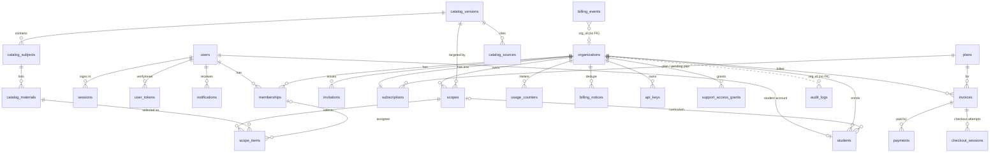

# Database design

PostgreSQL 16. Schema defined in migrations under `src/db/migrations/` (`0001_initial`, `0002_checkout_sessions`, `0003_catalog_verification`, `0004_catalog_notifications`, `0005_rate_limits`, `0006_ops_alerts`, `0007_students`, `0008_item_notes`, `0009_item_tracking`)
(Kysely migrator, static registry in `src/db/migrator.ts`). TypeScript row types: `src/db/types.ts`.

## 1. Entity relationship diagram



## 2. Tables

| Table | Purpose | Key constraints | RLS |
| --- | --- | --- | --- |
| `users` | Accounts | `kind` `staff`/`student` (never changes: trigger); `email` lower-case, unique, required for staff and absent for students (check `users_kind_identity`, which also forbids students from being platform admins or using MFA); status; MFA fields (secret AES-GCM encrypted); lockout counters; `trial_used`; `catalog_emails` (catalogue update emails opt-out); `assignment_emails` (emails when books are assigned) | — |
| `organizations` | Tenants | slug unique & pattern-checked; status `active/suspended` | — (read via membership) |
| `memberships` | User ↔ org with role | PK `(org_id, user_id)`; **partial unique index: one owner per org**; staff accounts only (trigger) | org **or** own user rows |
| `students` | School-created student accounts (`docs/STUDENT_ACCOUNTS.md`) | PK `user_id` (a `kind = 'student'` user: trigger); unique `(org_id, username)`; username pattern; grade 1–12; `(scope_id, org_id)` references `scopes(id, org_id)` with `ON DELETE SET NULL (scope_id)`; deleting the row deletes the account (trigger) | org **or** own user row |
| `sessions` | Server-side sessions | id = SHA-256(token), 64 hex; state `active/mfa_pending`; `expires_at` | — |
| `user_tokens` | Email verification / password reset | `token_hash` unique; single use (`used_at`); expiry | — |
| `invitations` | Pending invites | `token_hash` unique; **one open invite per (org, email)**; role ≠ owner | ✓ |
| `catalog_versions` | Academic-year catalogue versions | status `draft/published/archived`; `grade_notes` JSONB | — (global) |
| `catalog_sources` | Citations per version | URL must be http(s) | — |
| `catalog_subjects` | Subject rows | unique `(version, grade, track, block, code)`; grade 1–12; track/status enums; verification columns (below) | — |
| `catalog_materials` | Selectable materials | unique `(subject, title)`; unique `(id, version_id)`; trigger keeps `version_id` = subject's; verification columns (below) | — |
| `scopes` | Content scopes (tenant data) | unique `(org_id, name)`; unique `(id, org_id, catalog_version_id)`; unique `(id, org_id)` (for students) | ✓ |
| `scope_items` | Selected materials, with the team's note and assignee | PK `(scope_id, material_id)`; composite FKs to scope (with org & version) and to material (with version); `note` 1–500 characters; `(org_id, assignee_id)` references `memberships`, so the assignee is a member of the same organization and is cleared (`ON DELETE SET NULL (assignee_id)`) when the membership ends; `status` (`todo`/`in_progress`/`done`) and `due_on` (a `date`, 2000–2100; read as `YYYY-MM-DD`, never as a time); `annotated_by`, `annotated_at` | ✓ |
| `api_keys` | Read API keys | `key_hash` unique; revocable | ✓ |
| `plans` | Commercial plans | id pattern; prices ≥ 0; `limits`, `features` JSONB (`limits.max_students` is 0 on every plan: student accounts off) | — (global) |
| `subscriptions` | One row per org | unique `org_id`; status `trialing/active/past_due` with checks (trial → `trial_ends_at`, past_due → `grace_until`) | ✓ |
| `invoices` | Invoices | `number` unique (sequence `invoice_number_seq`); kind; status `open/paid/void` | ✓ |
| `payments` | Payment attempts | unique `(provider, provider_txn_id)` — idempotency | ✓ |
| `checkout_sessions` | Hosted-checkout attempts | unique `(provider, provider_ref)`; a callback's invoice is resolved from the signed provider reference (Paymob order id), not from the echoed merchant reference | ✓ |
| `billing_events` | Webhook receipts | unique `(provider, event_id)` — idempotency; normalized payload only | — (system only) |
| `usage_counters` | Monthly metering | PK `(org_id, metric, period)` | ✓ |
| `billing_notices` | Sent lifecycle notices (dedupe) | PK `(org_id, kind, ref)` | ✓ |
| `audit_logs` | Security & change history | bigint identity; indexes by org/time, action, actor; **app role has no UPDATE** | ✓ |
| `support_access_grants` | Customer-granted support windows | reason length; expiry; revocation | ✓ |
| `notifications` | In-app notifications | per user | — |
| `catalog_notices` | Organizations already told about an academic year's catalogue (dedupe) | PK `(org_id, kind, ref)`; ref = academic year | ✓ |
| `email_outbox` | Transactional email queue | partial index on pending | — |
| `worker_heartbeats` | Liveness of background workers | PK name | — |
| `ops_alerts` | State of each operational alert (firing / resolved, first and last seen, last notified), so only one app instance sends each message | PK `key`; counts only in `summary`/`details` | — (no tenant data) |
| `rate_limits` | Counters for route-specific rate limits, shared by app instances | PK `key` = HMAC of route and client key (no IPs or emails); UNLOGGED (counters restart after a crash) | — (no tenant data) |

Verification columns on `catalog_subjects` and `catalog_materials`: `verification_status`
(`unverified` / `verified` / `needs_review`), `verification_source`, `verification_url` (http/https),
`verification_note`, `reviewed_by` (user, `ON DELETE SET NULL`), `reviewed_at`. A CHECK keeps them
consistent: unverified rows carry no review data; verified rows need a source and date; rows needing
review need a note and date.

All timestamps are `timestamptz` (UTC). `updated_at` is maintained by the `set_updated_at()` trigger.
Primary keys are UUIDs (`gen_random_uuid()`), except `audit_logs` (bigint identity for ordering and cursor pagination).

### Indexes (selection)
- Lookups by token/key hash: `sessions(id)`, `user_tokens(token_hash)`, `invitations(token_hash)`, `api_keys(key_hash)` — unique.
- Tenant listing: `scopes(org_id, updated_at desc)`, `invoices(org_id, created_at desc)`, `invitations(org_id, created_at desc)`, `audit_logs(org_id, created_at desc)`.
- Worker scans: partial indexes `subscriptions(trial_ends_at) WHERE status='trialing'`, `subscriptions(current_period_end) WHERE status IN ('active','past_due')`, `email_outbox(send_after) WHERE status='pending'`.
- Catalogue rendering: `catalog_subjects(version_id, grade, sort_order)`, `catalog_materials(subject_id, sort_order)`.

## 3. Row-Level Security

Helper functions read transaction-local settings:
`app_current_org()`, `app_current_user()`, `app_rls_bypass()`.

```sql
CREATE POLICY scopes_isolation ON scopes
  USING (app_rls_bypass() OR org_id = app_current_org())
  WITH CHECK (app_rls_bypass() OR org_id = app_current_org());
-- memberships and students: USING also allows user_id = app_current_user()
```

Settings are applied with `set_config(..., true)` (transaction-local), which is safe with
connection pooling. Tests prove: no rows without context; another tenant's context sees nothing;
cross-tenant `INSERT` is rejected; the app role cannot `UPDATE audit_logs` or `ALTER TABLE … DISABLE ROW LEVEL SECURITY`.

## 4. Database roles

| Role | Privileges | Used by |
| --- | --- | --- |
| Owner (`curriculum_owner`) | Owns schema objects | Migrations, seeding only (`MIGRATION_DATABASE_URL`) |
| App (`curriculum_app`) | `SELECT/INSERT/UPDATE/DELETE` on tables except no `UPDATE` on `audit_logs`; sequences; no `BYPASSRLS` | App and worker (`DATABASE_URL`) |
| Backup (`curriculum_backup`) | `pg_read_all_data` + `BYPASSRLS`, read-only | `scripts/backup.sh` |
| Superuser | Cluster administration | Restores (`scripts/restore.sh`) |

`npm run db:migrate` (or `node dist/db/migrate-cli.js up`) applies migrations and, when
`APP_DB_ROLE` is set, re-applies the app role's grants. Roles are created by
`deploy/postgres-init/01-roles.sh` (Docker) or manually on a managed database.

Why backups need their own role: `FORCE ROW LEVEL SECURITY` applies RLS to the owner too, so
`pg_dump` as the owner fails ("query would be affected by row-level security policy") — verified.

## 5. Migrations and seed data

| Command | Effect |
| --- | --- |
| `npm run db:migrate` | Apply pending migrations (owner connection) + grants |
| `npm run db:migrate:down` | Revert the latest migration (development only) |
| `npm run db:seed` | Plans + 2026/2027 catalogue + **demo users (development only; refused in production)** |
| `node dist/db/seed-cli.js --catalog-only` | Production-safe: plans (insert-only, never overwrites edited prices) + catalogue (only if that year is absent) |

Demo credentials come from `DEMO_PASSWORD` or are generated randomly and printed once; they
are never created when `NODE_ENV=production`.

## 6. Data retention

| Data | Retention | Mechanism |
| --- | --- | --- |
| Sessions | until expiry (≤ 30 d) or 7 d idle | worker cleanup hourly |
| Verification/reset tokens | 7 d after expiry/use | worker |
| Sent/failed emails | 30 d; bodies redacted immediately after delivery | worker |
| Read notifications | 180 d | worker |
| Expired unaccepted invitations | 90 d after expiry | worker |
| Rate-limit counters | until their window ends (≤ 1 h) | worker hourly |
| Resolved operational alerts | 90 d after resolution | worker |
| Audit logs | `AUDIT_RETENTION_DAYS` (default 730 d); customers see their plan's window | worker |
| Billing records (invoices, payments, events) | Kept (financial records) — define the legal period with your accountant | none (manual) |
| Deleted organizations | Tenant rows removed immediately (cascade), student accounts included; the deletion audit entry is kept | API |
| Student accounts | Until the school removes the student or deletes the organization; then the account, its sessions and notifications are deleted | API (trigger `students_delete_account`) |
| Backups | `RETENTION_DAYS` (default 14 d locally) + off-site policy | `scripts/backup.sh` |

## 7. Backups

See DEPLOYMENT_GUIDE.md §Backups. Daily logical dumps (custom format) by the backup role,
optional GPG encryption, SHA-256 checksum, local retention; `scripts/verify-backup.sh` restores into
a scratch database and checks migrations, row counts, RLS flags and invariants. For point-in-time
recovery use a managed PostgreSQL service with WAL archiving.
