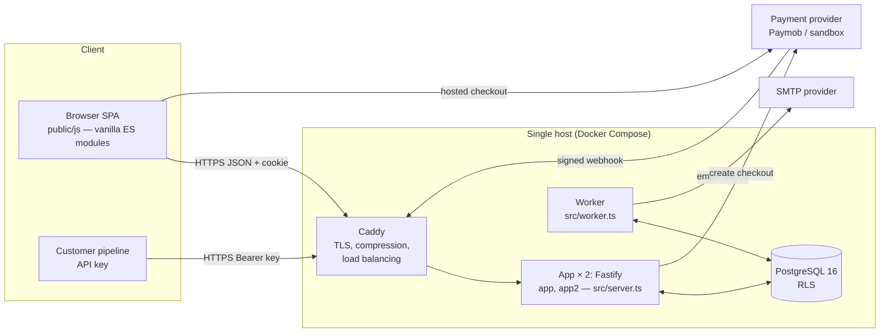

# SaaS architecture

## 1. Overview

| Component | Responsibility | Code |
| --- | --- | --- |
| Web app | REST API (`/api/*`), static SPA, health endpoints; two instances in production | `src/app.ts`, route modules |
| Worker | Email outbox delivery, subscription lifecycle (trial end, renewals, grace), due-date reminders, retention cleanup, heartbeat | `src/worker.ts`, `src/jobs/tasks.ts`, `src/billing/service.ts`, `src/scopes/reminders.ts` |
| PostgreSQL | All state; Row-Level Security for tenant tables | `src/db/migrations/` |
| SPA | Picker and management UI; no build step; strict CSP | `public/` |
| Alert monitor | In each app instance: checks the worker heartbeat, email delivery, server errors, payment webhooks, migrations and the database every minute; sends alerts by SMTP and webhook (one instance per message, via `ops_alerts`) | `src/ops/alerts.ts` |
| Caddy | Automatic TLS, compression, load balancing across the two app instances (readiness checked every 2 s; failed connections tried on the other instance) | `deploy/Caddyfile` |

**Technology choices** (kept close to the original vanilla-JS artifact, avoiding unnecessary
frameworks): Node.js 22 + TypeScript (strict), Fastify 5, Kysely query builder over `pg`, Zod
validation, `@node-rs/argon2`, `otplib` (TOTP), `nodemailer`, `qrcode`. Front end: plain ES
modules, no bundler; fonts self-hosted from `@fontsource`.

## 2. Multi-tenancy decision

| Option | Isolation | Ops cost | Fit |
| --- | --- | --- | --- |
| Shared DB, shared schema, `org_id` column | Logical; depends on every query | Lowest: one schema, one migration path, cheap per tenant | Good for many small B2B tenants with small data (a scope is ≤ ~1,000 rows) |
| Shared DB, schema per tenant | Stronger namespace isolation | Migrations × tenants, connection/search_path handling, harder cross-tenant reporting | Overkill at this data size |
| Database per tenant | Strongest | Highest (provisioning, backups, upgrades per tenant) | Only for regulated enterprise contracts |

**Chosen: shared schema with `org_id` on every tenant-owned row, enforced three ways:**

1. **Application guard** — `inOrg(ctx, req, orgId, minRole, fn)` (`src/auth/guards.ts`) loads the
   caller's membership for the org named in the URL. Non-members get **404** (existence is not
   disclosed). The org id from the URL is only a selector; authority comes from the authenticated
   session's membership row.
2. **Row-Level Security** — every tenant table (`scopes`, `scope_items`, `invitations`, `api_keys`,
   `subscriptions`, `invoices`, `payments`, `usage_counters`, `billing_notices`, `audit_logs`,
   `support_access_grants`, `students`, `item_reminders`, and `memberships`) has `ENABLE` + `FORCE ROW LEVEL SECURITY` with
   policies keyed on transaction-local settings:
   - `withOrgContext()` sets `app.current_org` → only that tenant's rows are visible/writable;
   - `withUserContext()` sets `app.current_user` → a user sees only their own memberships;
   - `withSystemContext()` sets `app.rls_bypass` → explicit, reviewed cross-tenant work (worker,
     webhooks, platform admin, token lookups).
   With no context, tenant tables return **no rows** — a forgotten `WHERE org_id = …` fails closed.
   The app connects as a role with neither `SUPERUSER` nor `BYPASSRLS`; the server refuses to
   start in production otherwise (`inspectRole`).
3. **Composite foreign keys** — `scope_items (scope_id, org_id, catalog_version_id)` references
   `scopes (id, org_id, catalog_version_id)` and `(material_id, catalog_version_id)` references
   `catalog_materials (id, version_id)`, so an item cannot point at another tenant's scope or at a
   material from another catalogue year.

Tenant boundaries in other subsystems: exports and API responses are produced inside the tenant
context; caches hold only the global catalogue (not tenant data); the worker processes each org in
its own transaction; there is no tenant file storage.

## 3. Request lifecycle

1. `onRequest`: resolve the caller — session cookie (`sid` / `__Host-sid`, SHA-256 hashed lookup,
   idle 7 d / absolute 30 d (12 h for platform admins)) or, for `/api/v1/*`, an API key.
2. Rate limiting (global 600/min/IP when enabled, a per-process flood guard in memory; stricter
   per-route limits on auth, invitations, billing and API v1 120/min, counted in PostgreSQL so they
   hold across app instances: `src/http/rate-limit-store.ts`).
3. `preHandler` CSRF defence: `Origin` must match `APP_URL`, `Sec-Fetch-Site: cross-site` rejected,
   and cookie-authenticated mutations must send `X-CSRF-Token = HMAC(SESSION_SECRET, session id)`.
   Only `application/json` bodies are parsed (HTML forms cannot send them).
4. Route handler: Zod validation → guard (`requireUser`, `inOrg`, `requirePlatformAdmin`) →
   business logic in one transaction → audit entry in the same transaction.
5. Error handler: `AppError` → `{ error: { code, message, details } }`; unknown errors → 500 with a
   request id, no internals.

## 4. Authorization matrix (organization)

| Capability | Viewer | Editor | Admin | Owner |
| --- | :-: | :-: | :-: | :-: |
| Browse catalogue, read scopes, copy list, export (plan permitting) | ✓ | ✓ | ✓ | ✓ |
| Create/edit/duplicate/delete scopes, change selections | | ✓ | ✓ | ✓ |
| Invite editors/viewers, change their roles, remove them | | | ✓ | ✓ |
| Invite or manage admins | | | | ✓ |
| Org settings, API keys, audit log, view billing | | | ✓ | ✓ |
| Subscribe/upgrade/downgrade/cancel, pay invoices | | | | ✓ |
| Require MFA policy, support access grants, transfer ownership, delete org | | | | ✓ |
| Leave the organization | ✓ | ✓ | ✓ | (transfer first) |

Platform administrators are a separate axis (`users.is_platform_admin`), require an
MFA-verified session, and do **not** gain organization membership. Customer scope contents are
readable only through an active support grant (see SECURITY_DESIGN.md).

## 5. Billing architecture

- `PaymentProvider` interface (`src/billing/providers/types.ts`): `createCheckout()` and
  `parseWebhook()` (signature verification + normalisation). Implementations: `SandboxProvider`
  (dev/test; refused in production by config validation) and `PaymobProvider` (Intention API +
  Unified Checkout + HMAC-SHA512 callback; contract-tested against a simulator, **not yet run against a Paymob account**).
- **Our database is the source of truth.** Providers only report money movements; the billing
  service applies them (`applyProviderEvent`) inside the webhook transaction.
- Idempotency: `billing_events (provider, event_id)` unique; `payments (provider, provider_txn_id)`
  unique; amounts and currency must match the invoice.
- Renewals are invoices paid through the same hosted checkout (works for cards, wallets, offline
  payment marked paid by an admin). Card-on-file auto-renewal can be added behind the interface.
- Time-based transitions run in the worker *and* are evaluated on read (`effectivePlan`), so a
  delayed worker never extends paid access.

## 6. Background work

| Job | Interval | Notes |
| --- | --- | --- |
| Email outbox | every tick (default 15 s) | `FOR UPDATE SKIP LOCKED`; exponential backoff; 8 attempts; body redacted after delivery |
| Billing lifecycle | every tick | Trial notices (once), trial expiry, renewal invoices (once per period), past-due, grace expiry, scheduled cancellation |
| Due-date reminders | every 15 min; sends only from 08:00 to 21:00 Cairo time | Per member and organization, one in-app notice and (if allowed) one email listing books due today or in the next 2 days and books overdue by up to 7 days; done books, suspended accounts and suspended organizations are skipped. Each book is claimed in `item_reminders` (insert, skip on conflict) in the same transaction as the notice and email, so concurrent workers never repeat one |
| Retention cleanup | hourly | Expired sessions/tokens, old emails/notifications/invitations, audit logs past `AUDIT_RETENTION_DAYS` |
| Heartbeat | every tick | `worker_heartbeats`; container health check and admin health page |

Several workers can run concurrently (row locks, notice dedupe), but one is enough at launch.

## 7. Capacity and scaling

Measured on the 4-vCPU development sandbox with one Node process (TEST_REPORT.md): ~250–500
requests/s on the main endpoints at p95 ≤ 152 ms. Expected first-year load (≤ 1,000 organizations,
a few thousand users, bursty interactive use) is well below that. Scaling path, in order:

1. Vertical: bigger host, `DATABASE_POOL_MAX`.
2. Managed PostgreSQL with automated backups/PITR.
3. Several app containers behind Caddy — **done for two** (`app`, `app2`): sessions, rate limits
   and the catalogue cache work across instances, restarts are rolling with a drain. A third is one
   more service and upstream; each instance holds up to `DATABASE_POOL_MAX` database connections.
4. Read replica for the catalogue and admin analytics if ever needed.

## 8. Key decisions (ADR summary)

| # | Decision | Rationale |
| --- | --- | --- |
| ADR-1 | Keep a no-build vanilla JS front end | Matches the original; tiny surface; strict CSP without hashes |
| ADR-2 | Shared schema + RLS | Best cost/isolation balance at this data size; DB-enforced defence in depth |
| ADR-3 | Server-side sessions, not JWT | Instant revocation (logout, suspension, password change) |
| ADR-4 | Invoice-per-period renewals | Works with Egyptian payment methods; provider-independent |
| ADR-5 | Transactional email outbox | Emails only for committed changes; retries; no SMTP latency in requests |
| ADR-6 | Support access by customer grant, no impersonation | Admins don't see customer data by default; full audit trail |
| ADR-7 | Catalogue versions immutable once published | Scopes keep referring to exactly what was chosen |
