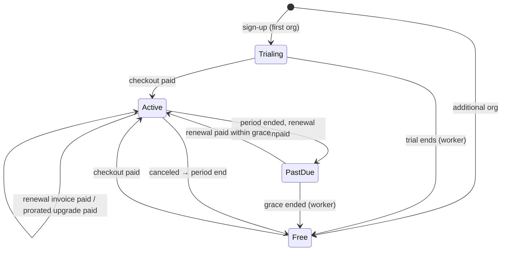

# Subscription model, billing and usage limits

Plans are seeded from `src/billing/plans.ts` and can be edited at runtime by platform admins
(`/admin/plans`). Prices are stored in piastres (1/100 EGP). USD equivalents use **52.5 EGP/USD**,
the mid-October 2026 market level (52.4–52.8 reported; [rate history](https://www.poundsterlinglive.com/history/USD-EGP-2026)) —
an assumption to revisit, since the pound has ranged roughly 46.6–54.8 in 2026.

## 1. Plans (launch proposal)

| | Free | Starter | Professional | Enterprise |
| --- | --- | --- | --- | --- |
| Monthly | EGP 0 | **EGP 990** (~$19) | **EGP 2,900** (~$55) | Custom |
| Yearly | — | EGP 9,900 (2 months free) | EGP 29,000 | Custom contract |
| Seats (members + pending invites) | 2 | 5 | 25 | Unlimited* |
| Content scopes | 1 | 10 | 100 | Unlimited* |
| Exports per month | 5 | 100 | 1,000 | Unlimited* |
| Export formats | TXT | TXT, CSV, JSON | TXT, CSV, JSON | TXT, CSV, JSON |
| Read API (`/api/v1`) | — | — | 50,000 requests/month | Unlimited* |
| Audit-log window | 7 days | 30 days | 365 days | 730 days |
| Enforce 2FA for admins | — | ✓ | ✓ | ✓ |
| Priority support | — | — | — | ✓ |
| Student accounts (`max_students`) | — | — | — | —** |
| Purchase | — | Self-serve | Self-serve | Sales (`SALES_EMAIL`), manual invoice |

\* Defaults; per-organization overrides via `PATCH /api/admin/orgs/:id/subscription {limitOverrides}`.
\*\* Student accounts (`docs/STUDENT_ACCOUNTS.md`) are not priced yet: 0 on every plan, enabled for a
school only by a platform administrator's `max_students` override (which, like other overrides, has
no effect while the school is on Free). Pricing them is an open commercial decision.

Every plan includes the full catalogue, the picker, "Copy list" and the Arabic interface — the
original free functionality is never paywalled. Pricing rationale: COMMERCIAL_FEASIBILITY.md.

### Trial
- First organization created by a user: **14-day Professional trial** (`TRIAL_DAYS`), no card.
- Additional organizations by the same user start on Free (`users.trial_used`), preventing trial cycling.
- 3 days before the end, one "trial ending" email; at the end the org moves to Free and gets a
  "trial ended" email.

## 2. Enforcement (server-side)

| Limit | Where | Behaviour at the limit |
| --- | --- | --- |
| Seats | invite (`assertSeatAvailable`, org row lock) | `402 PLAN_LIMIT_REACHED`; existing members keep access |
| Scopes | create/duplicate (`assertScopeAvailable`) | `402`; when already over (after a downgrade) the **oldest N scopes stay editable**, newer ones are read-only, nothing is deleted |
| Exports / API requests | atomic conditional upsert on `usage_counters` (UTC month) | `402` until next month or upgrade |
| Features (CSV/JSON, API, MFA policy) | `requireFeature` | `402 FEATURE_NOT_IN_PLAN` |
| Student accounts | add or import (`assertStudentCapacity`, org row lock; an import counts as a whole) | 0: `402 STUDENTS_NOT_ENABLED` and students cannot sign in; at the limit: `402 PLAN_LIMIT_REACHED`, existing students keep access |

The effective plan is computed on every request from the subscription row and the clock
(`effectivePlan`), so expiry is enforced even if the worker is late.

## 3. Lifecycle

| Event | Rule |
| --- | --- |
| Subscribe (from Free/Trial) | Invoice for the full period; period starts when payment is confirmed |
| Upgrade (same interval, higher price) | Immediate after payment; charge = ⌈(new − old) × remaining / period length⌉; period unchanged |
| Downgrade or interval change | Scheduled (`pending_plan_id`); the renewal invoice is issued for the new plan and applies it when paid |
| Cancel | `cancel_at_period_end`; no renewal invoice; at period end → Free; "Keep my subscription" undoes it |
| Renewal | Invoice created `RENEWAL_NOTICE_DAYS` (7) before period end, emailed with a pay link; new period starts at the old period end |
| Non-payment | At period end → past due, `GRACE_DAYS` (7) of continued access, emails; then Free; open renewal invoices voided |
| Failed payment | Recorded; invoice stays open; owner emailed and notified; retry from Billing |
| Manual (Enterprise/offline) | Admin assigns plan/period or creates a manual invoice and marks it paid |

Invoices are numbered `INV-<year>-<6 digits>` from a database sequence. Payment history keeps
every attempt (succeeded and failed).

## 4. Payment provider selection

| Provider | Egyptian company can sign up | EGP | Methods | Recurring | Notes |
| --- | --- | --- | --- | --- | --- |
| **Paymob** | Yes (Egyptian PSP) | Yes, settles in EGP | Cards, mobile wallets, kiosks, installments (by account) | Subscription module via account manager ([docs](https://docs.paymob.com/docs/subscription)) | Published rate "from 2.75%" per a comparison site — confirm with Paymob |
| Fawry / PayTabs / MyFatoorah | Yes | Yes | Cards, Fawry reference, wallets | Varies | Alternatives if Paymob terms are unsuitable |
| Stripe | Not natively for Egyptian businesses (needs a foreign entity) | Charges in EGP possible from supported entities | Cards | Excellent | Only if the company is registered abroad (e.g. US/UAE/UK) |
| Paddle / Lemon Squeezy (merchant of record) | Depends on payout support | USD-priced | Cards, PayPal | Yes | Handles global VAT; better for non-Egyptian customers |

**Recommendation:** an Egyptian-registered company selling mainly to Egyptian organizations in EGP
should start with **Paymob** (implemented and contract-tested adapter, pending a run against Paymob). A company
registered abroad selling regionally in USD should consider Stripe or a merchant of record; only a
new `PaymentProvider` implementation is needed. **Company registration country, target countries
and tax position are open business decisions** (PROJECT_STATUS.md).

## 5. What is built vs. blocked

| Item | Status |
| --- | --- |
| Plans, limits, metering, lifecycle, invoices, emails, admin tools | COMPLETE (tested with the sandbox provider) |
| Webhook security (signature, replay, idempotency, amount check) | COMPLETE (sandbox tested; Paymob contract-tested, HMAC matches an independent implementation) |
| Paymob checkout + webhook against Paymob servers | **BLOCKED** — needs Paymob test-mode keys (secret/public keys, HMAC secret, card integration id); then `npm run paymob:check` |
| Card-on-file automatic renewal | NOT STARTED (deliberate; invoice-per-period first) |
| Refunds | Manual in the provider dashboard; refund/void callbacks are recorded as "ignored — manual review" |
| Tax (VAT 14%) on invoices, ETA e-invoicing | NOT STARTED — needs the company's tax registration details |
