

# نطاق المناهج: دليل الاستخدام

يساعد «نطاق المناهج» المدارس ودور النشر وشركات تكنولوجيا التعليم على اختيار الكتب والبرامج التي تغطيها منصتها من المنهج المصري، من الصف الأول الابتدائي حتى الثالث الثانوي. يحفظ الفريق اختياراته في قوائم مسمّاة اسمها **نطاقات المحتوى**، ويضيف إلى كل كتاب ملاحظة، ويسند الكتب إلى الزملاء بتواريخ استحقاق، ثم ينقل كل قائمة إلى دليل العام الدراسي الجديد عند نشره. ويمكن للمدرسة أيضًا أن تنشئ حسابات لطلابها، فيرى كل طالب الكتب المختارة لصفه.

يشرح هذا الدليل كل أجزاء النظام شاشةً بشاشة، بالترتيب الذي تمر به المدرسة، ثم لوحة إدارة المنصة. الواجهة كلها متاحة بالعربية والإنجليزية (انظر [القسم 15](#15-الإنجليزية-والهاتف)).

> **عن الصور.** التُقطت الصور من مدرسة تجريبية على خادم اختبار، والأشخاص والمدرسة والعناوين كلها أسماء مُتخيَّلة، والدفع فيها عبر صفحة الدفع التجريبية (لا تنتقل أي أموال). تختلف بعض التفاصيل عن الخادم الفعلي، وتشير التعليقات تحت الصور إلى ذلك. لإعادة التقاط الصور بعد أي تغيير في الواجهة، شغّل `npm run docs:screenshots:ar` (انظر [عن هذا الدليل](#عن-هذا-الدليل)).
>
> **ما يظهر بالإنجليزية.** عناوين الكتب ومعظم ملاحظات الدليل مسجّلة في الدليل بالإنجليزية كما تصدرها الوزارة ودور النشر، فتظهر كذلك داخل الواجهة العربية، بينما تظهر أسماء المواد والصفوف بالعربية والإنجليزية معًا.

## المحتويات

1. [الخطط وإنشاء حساب](#1-الخطط-وإنشاء-حساب)
2. [تسجيل الدخول](#2-تسجيل-الدخول)
3. [الأدوار والصلاحيات](#3-الأدوار-والصلاحيات)
4. [دليل المناهج: اختيار الكتب](#4-دليل-المناهج-اختيار-الكتب)
5. [النطاقات: القائمة والنسخ والمقارنة](#5-النطاقات-القائمة-والنسخ-والمقارنة)
6. [الملاحظات والمسؤولون والحالة وتاريخ الاستحقاق](#6-الملاحظات-والمسؤولون-والحالة-وتاريخ-الاستحقاق)
7. [الإشعارات ومهامي](#7-الإشعارات-ومهامي)
8. [الأعضاء والدعوات](#8-الأعضاء-والدعوات)
9. [عام دراسي جديد: نقل النطاق](#9-عام-دراسي-جديد-نقل-النطاق)
10. [الفوترة](#10-الفوترة)
11. [الطلاب وبوابة الطلاب](#11-الطلاب-وبوابة-الطلاب)
12. [إعدادات المؤسسة: مفاتيح API وإشعارات الأنظمة ووصول الدعم](#12-إعدادات-المؤسسة-مفاتيح-api-وإشعارات-الأنظمة-ووصول-الدعم)
13. [سجل التدقيق](#13-سجل-التدقيق)
14. [حسابك](#14-حسابك)
15. [الإنجليزية والهاتف](#15-الإنجليزية-والهاتف)
16. [رسائل البريد التي يرسلها النظام](#16-رسائل-البريد-التي-يرسلها-النظام)
17. [إدارة المنصة](#17-إدارة-المنصة)
18. [حدود وملاحظات مهمة](#18-حدود-وملاحظات-مهمة)

---

## 1. الخطط وإنشاء حساب

### الأسعار

صفحة **«الأسعار»** (`/pricing`) متاحة للجميع. الدليل نفسه متاح في كل الخطط، وتختلف الخطط في حجم الفريق وعدد النطاقات وعمليات التصدير والتكاملات. اختر **«شهري»** أو **«سنوي»** لعرض السعر المناسب.

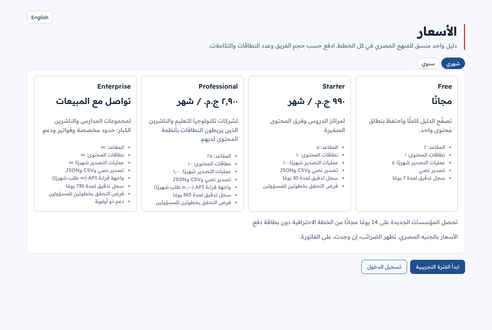

| الخطة | السعر | المقاعد | النطاقات | التصدير شهريًا | إضافات |
|---|---|---|---|---|---|
| Free | مجانًا | 2 | 1 | 5 | تصدير نصي، سجل تدقيق 7 أيام |
| Starter | ‏990 ج.م. شهريًا | 5 | 10 | 100 | تصدير CSV وJSON، سجل تدقيق 30 يومًا، فرض التحقق بخطوتين على المسؤولين |
| Professional | ‏2,900 ج.م. شهريًا | 25 | 100 | 1,000 | واجهة قراءة API (‏50,000 طلب شهريًا) وإشعارات الأنظمة، سجل تدقيق 365 يومًا |
| Enterprise | تواصل مع المبيعات | بلا حد | بلا حد | بلا حد | دعم ذو أولوية، سجل تدقيق 730 يومًا، فواتير |

الأسعار بالجنيه المصري، وتظهر الضرائب، إن وُجدت، على الفاتورة. يمكن لمسؤول المنصة تعديل الأسعار (القسم 17)، ويسري التعديل على الفواتير الجديدة فقط.

### إنشاء حساب

اضغط **«ابدأ الفترة التجريبية»** (أو **«إنشاء حساب»** من صفحة الدخول). اكتب اسمك وبريدك الإلكتروني وكلمة مرور من 10 أحرف على الأقل واسم مؤسستك: شركتك أو مدرستك أو فريقك.

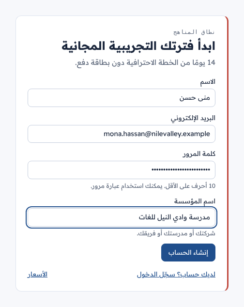

تحصل المؤسسة الجديدة على **14 يومًا من خطة Professional** دون بطاقة دفع. بعد **«إنشاء الحساب»** يصلك بريد فيه رابط تأكيد صالح لمدة 48 ساعة:

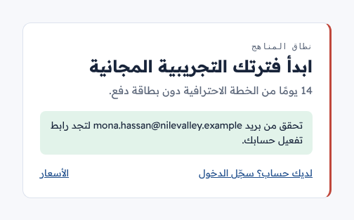

افتح الرابط لتأكيد بريدك:

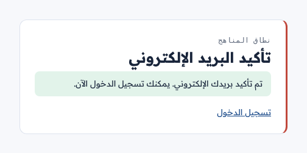

لا يستخدم من دعاه زميله هذا النموذج، بل يقبل الدعوة مباشرة (القسم 8).

## 2. تسجيل الدخول

سجّل الدخول ببريدك وكلمة المرور من صفحة `/login`.

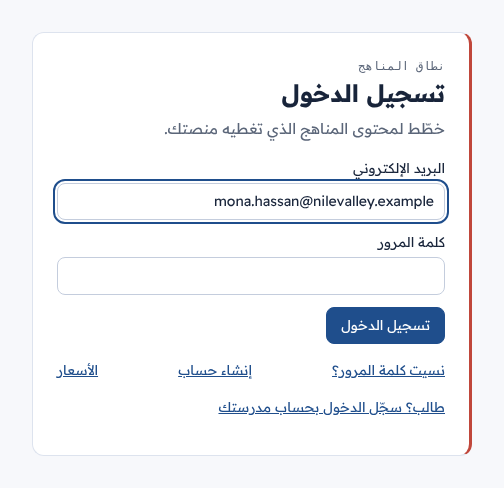

- **«نسيت كلمة المرور؟»** ترسل إلى بريدك رابطًا لاختيار كلمة مرور جديدة. يعمل الرابط مرة واحدة وتنتهي صلاحيته بعد ساعة، وتغيير كلمة المرور يُخرج جلساتك الأخرى.

  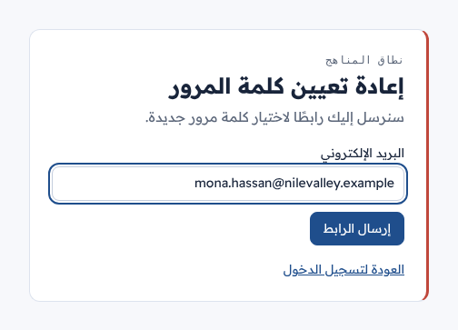

  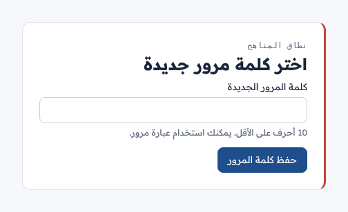

- **التحقق بخطوتين.** إذا فعّلته (القسم 14) أو فرضته مؤسستك على المالك والمسؤولين، تطلب الصفحة التالية الرمز المكوّن من 6 أرقام من تطبيق المصادقة. إن فقدت هاتفك فاستخدم أحد رموز الاسترداد.

  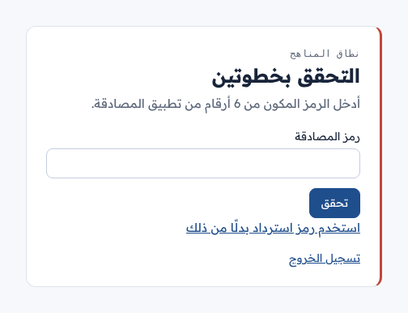

- **الطلاب** لهم صفحة دخول خاصة، ورابطها أسفل صفحة الدخول (القسم 11).

بعد عدة محاولات خاطئة يُقفل الحساب مؤقتًا، ويمكن لمسؤول المنصة فك القفل (القسم 17).

## 3. الأدوار والصلاحيات

لكل شخص في المؤسسة دور واحد، وتعرض صفحة **«الأعضاء»** الأدوار.

| الدور | يمكنه |
|---|---|
| **المالك** | كل شيء، بما في ذلك الفوترة ونقل الملكية ووصول الدعم وحذف المؤسسة. للمؤسسة مالك واحد. |
| **مسؤول** | إدارة المحررين والمشاهدين والدعوات والطلاب والإعدادات ومفاتيح API وإشعارات الأنظمة، والاطلاع على سجل التدقيق والفوترة. |
| **محرر** | إنشاء النطاقات وتعديلها ونسخها ونقلها وحذفها، واختيار الكتب، وكتابة الملاحظات وإسناد الكتب. |
| **مشاهد** | قراءة النطاقات والملاحظات والمهام وتصديرها، دون تغيير أي شيء. |

تعرض القائمة العلوية ما يستطيع دورك استخدامه فقط: يرى المالك والمسؤولون **«الطلاب»** (عند تفعيل بوابة الطلاب) و**«الفوترة»** و**«الإعدادات»** و**«سجل التدقيق»**، ويرى المحررون والمشاهدون **«دليل المناهج»** و**«النطاقات»** و**«مهامي»** و**«الأعضاء»**.

## 4. دليل المناهج: اختيار الكتب

صفحة **«دليل المناهج»** هي الشاشة الرئيسية. تعرض الدليل الكامل للعام الدراسي الخاص بالنطاق، صفًا بصف. وكل كتاب تحدده يُضاف إلى النطاق المختار لكل أعضاء مؤسستك.

### نطاقك الأول

لا توجد نطاقات في المؤسسة الجديدة، لذلك تبدأ الصفحة بدعوة لإنشاء النطاق الأول:

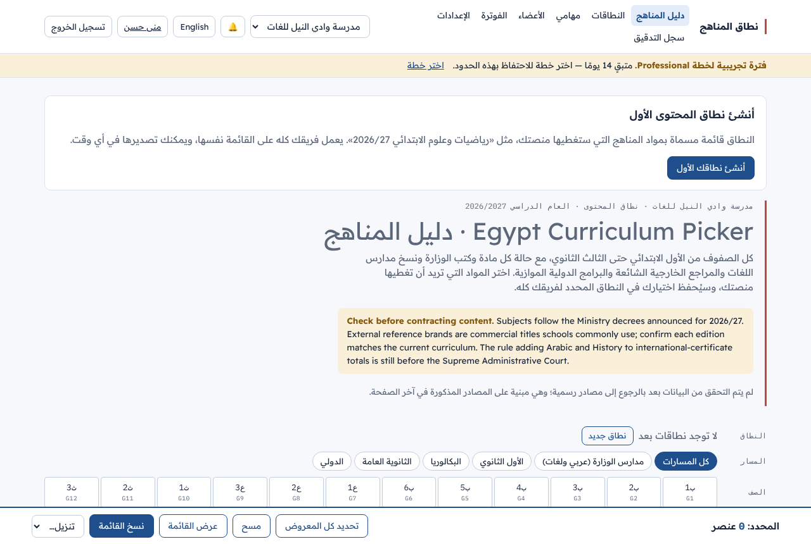

يعرض الشريط الأصفر أسفل القائمة الأيام المتبقية من الفترة التجريبية، ورابط **«اختر خطة»** فيه يفتح صفحة الفوترة. أما الإشعار الأصفر داخل الصفحة فهو تنبيه الدليل نفسه ويكتبه فريق المنصة.

يطلب زر **«أنشئ نطاقك الأول»** (أو **«نطاق جديد»** لاحقًا) اسمًا ووصفًا اختياريًا وإصدار الدليل:

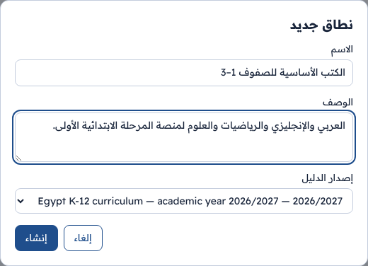

### عوامل التصفية

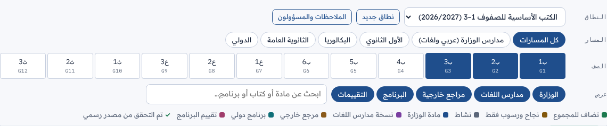

- **«النطاق»**: القائمة التي تعدّلها الآن. **«نطاق جديد»** ينشئ قائمة أخرى، و**«الملاحظات والمسؤولون»** تفتح صفحة الملاحظات لهذا النطاق (القسم 6).
- **«المسار»**: مدارس الوزارة (عربي ولغات)، الأول الثانوي، البكالوريا، الثانوية العامة، الدولي، أو **«كل المسارات»**.
- **«الصف»**: ب1–ب6، ع1–ع3، ث1–ث3. اضغط عدة صفوف لعرضها معًا، واضغط الصف المحدد مرة أخرى لإخفائه.
- **«عرض»**: أنواع الكتب المعروضة: الوزارة، مدارس اللغات، مراجع خارجية، البرنامج، التقييمات.
- **«بحث»** عن مادة أو كتاب أو برنامج بالاسم.
- **«مفتاح الألوان»** يشرح الألوان: حالة المادة (تضاف للمجموع، نجاح ورسوب فقط، نشاط) ونوع كل كتاب.

### اختيار الكتب

تعرض كل مادة اسمها بالعربية والإنجليزية وحالتها وكتبها. اضغط الكتاب لإضافته واضغطه مرة أخرى لإزالته. يعرض الشريط السفلي **«تم الحفظ»** بعد كل تغيير، ويعدّ العناصر المحددة.

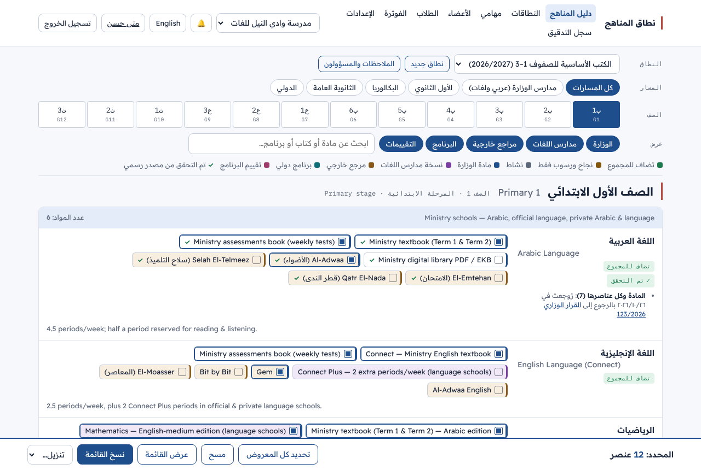

- **✓ تم التحقق.** العلامة الخضراء تعني أن مسؤول المنصة راجع المادة على مصدر رسمي (قرار وزاري أو صفحة الناشر). افتح شارة **«تم التحقق»** لترى المصدر وتاريخ المراجعة. ويعرض سطر أعلى عوامل التصفية عدد المواد التي تم التحقق منها حتى الآن. أما المواد التي لا تحمل العلامة فمصدرها المراجع المذكورة آخر الصفحة، فراجعها قبل التعاقد على المحتوى.
- **✎** على الكتاب تعني أن له ملاحظة أو مسؤولًا أو حالة أو تاريخ استحقاق (القسم 6). إزالة كتاب كهذا تطلب تأكيدًا، لأن ملاحظته وإسناده يُحذفان معه.
- **«تحديد كل المعروض»** يضيف كل الكتب الظاهرة بعد التصفية، و**«مسح»** يفرّغ النطاق بعد التأكيد.

### قائمتك: نسخها وتنزيلها

**«عرض القائمة»** يعرض الاختيار نصًّا مرتبًا حسب الصف والمادة، و**«نسخ القائمة»** ينسخ هذا النص، و**«تنزيل…»** يحفظ النطاق بصيغة **TXT** أو **CSV** أو **JSON**. تحتاج صيغتا CSV وJSON إلى خطة Starter أو أعلى، وكل تنزيل يُحسب من عمليات التصدير الشهرية. ويتضمن ملفا CSV وJSON حالة التحقق والملاحظة والمسؤول والحالة وتاريخ الاستحقاق لكل كتاب.

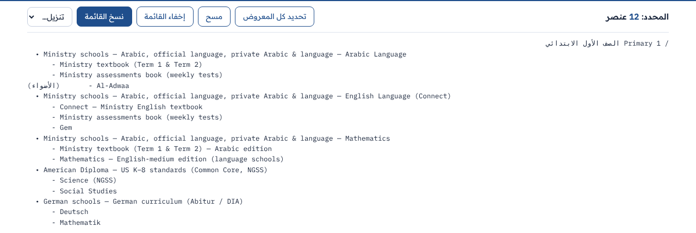

### المشاهدون

يرى المشاهد الصفحة نفسها، لكن الكتب لا تستجيب للضغط، ويظهر في شريط النطاق **«للقراءة فقط: لا يمكن للمشاهدين تغيير الاختيارات.»**، وتظهر الرسالة نفسها إن حاول الضغط.

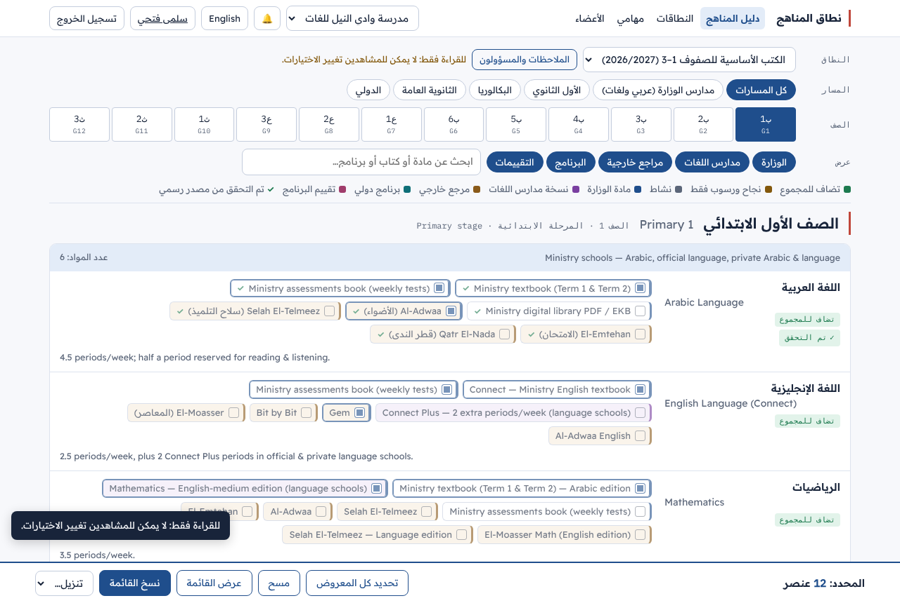

والنطاق الزائد عن حد الخطة (بعد الانتقال إلى خطة أصغر) يصبح للقراءة فقط أيضًا، برسالة خاصة به.

## 5. النطاقات: القائمة والنسخ والمقارنة

تعرض صفحة **«النطاقات»** نطاقات المؤسسة، وعدد النطاقات الذي تسمح به خطتك.

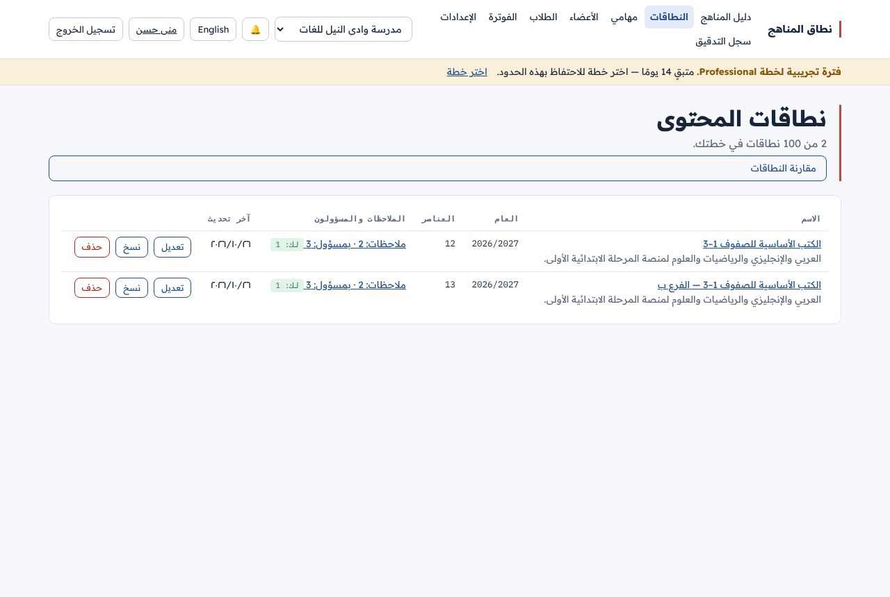

لكل نطاق:

- **الاسم** يفتحه في دليل المناهج.
- **رابط الملاحظات** («ملاحظات: 2 · بمسؤول: 3») يفتح صفحة ملاحظاته، و«لك: 1» عدد الكتب المسندة إليك.
- **«تعديل»** لتغيير الاسم أو الوصف.
- **«نسخ»** ينسخ النطاق بكتبه وملاحظاته وإسناداته باسم جديد (هنا «الكتب الأساسية للصفوف 1–3 — الفرع ب» لفرع ثانٍ يستبدل بعض الكتب)، ثم تفتح النسخة في دليل المناهج.
- **«حذف»** يحذف النطاق لكل الأعضاء بعد التأكيد.
- عند نشر دليل أحدث يظهر زر **«النقل إلى 2027/2028…»** (القسم 9).

### مقارنة نطاقين

تعرض **«مقارنة النطاقات»** الكتب التي يتضمنها كل نطاق، صفًا بصف. تعدّ البطاقات الكتب الموجودة في الأول فقط، وفي الثاني فقط، وفي كليهما. **«عرض الاختلافات فقط»** يخفي الكتب المشتركة، و**«تبديل»** يبدّل النطاقين، و**«تنزيل المقارنة (CSV)»** يحفظها (خطة Starter أو أعلى، وتُحسب عملية تصدير).

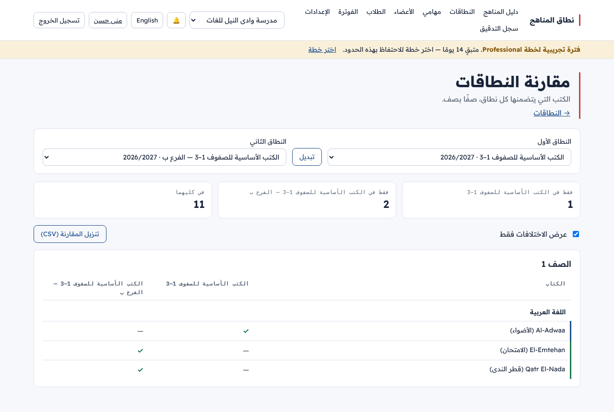

يمكن مقارنة نطاقين من عامين دراسيين مختلفين، وعندها تُطابَق الكتب حسب المادة والعنوان، ويُشار إلى الكتاب غير الموجود في دليل أحد العامين.

## 6. الملاحظات والمسؤولون والحالة وتاريخ الاستحقاق

لكل كتاب محدد ملاحظة قصيرة ومسؤول واحد من الأعضاء، وحالة (للتنفيذ، قيد التنفيذ، تم) وتاريخ استحقاق اختياري. افتح الصفحة من **«الملاحظات والمسؤولون»** في شريط النطاق أو من صفحة النطاقات.

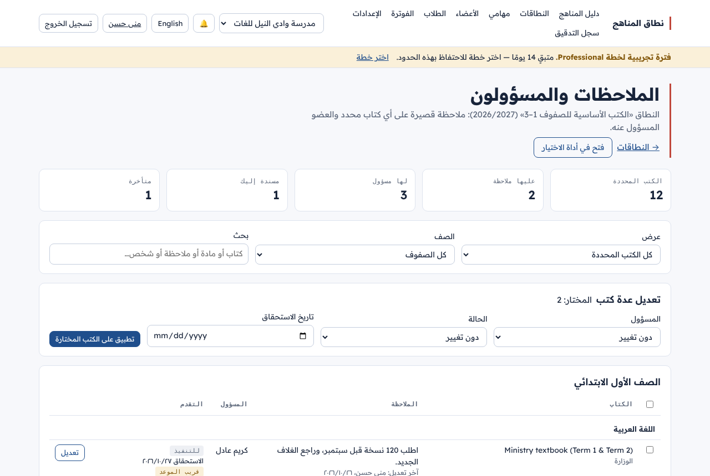

- تعدّ البطاقات العلوية الكتب المحددة، وما عليه ملاحظة، وما له مسؤول، وما أُسند إليك، والمتأخر.
- **«عرض»** يصفّي القائمة: كل الكتب المحددة، المسندة إليّ، عليها ملاحظة، لها مسؤول، بلا مسؤول، لم تكتمل بعد، المتأخرة، المكتملة. ويضيّقها **«الصف»** و**«بحث»** (في الكتاب والمادة والملاحظة والشخص).
- يعرض عمود **«التقدم»** الحالة وتاريخ الاستحقاق، و**«قريب الموعد»** (اليوم أو خلال يومين) أو **«متأخر»** (بعد تاريخ الاستحقاق حتى يكتمل الكتاب).
- تحت كل ملاحظة: من عدّلها آخر مرة ومتى.

### تعديل كتاب واحد

زر **«تعديل»** في الصف يفتح نافذة الملاحظة والمسؤول:

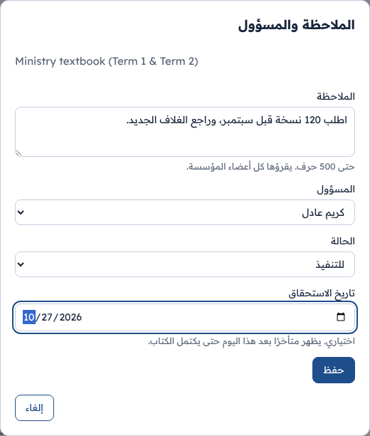

الملاحظة حتى 500 حرف ويقرؤها كل أعضاء المؤسسة. تعرض قائمة **«المسؤول»** أعضاء المؤسسة. وتاريخ الاستحقاق اختياري، ويظهر بتنسيق التاريخ المضبوط في جهازك.

### تعديل عدة كتب معًا

حدّد الكتب في القائمة (أو مربع رأس الصف لتحديد كل كتبه الظاهرة)، ثم اختر في شريط **«تعديل عدة كتب»** ما تريد تغييره: المسؤول أو الحالة أو تاريخ الاستحقاق. **«دون تغيير»** يُبقي الحقل كما هو. ثم اضغط **«تطبيق على الكتب المختارة»**.

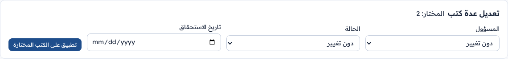

إسناد الكتب يُرسل إشعارًا إلى المسؤول (القسم 7). يستطيع المشاهد قراءة الصفحة دون تعديلها.

## 7. الإشعارات ومهامي

### الإشعارات

يعرض الجرس في الشريط العلوي عدد الإشعارات غير المقروءة، ويفتح قائمتها، و**«فتح»** ينقلك إلى الصفحة المعنية. تصل الإشعارات عند إسناد كتب إليك، وعند اقتراب موعد كتبك أو تأخرها، وعند نشر دليل عام جديد لنطاقاتك، وبعد الدفع.

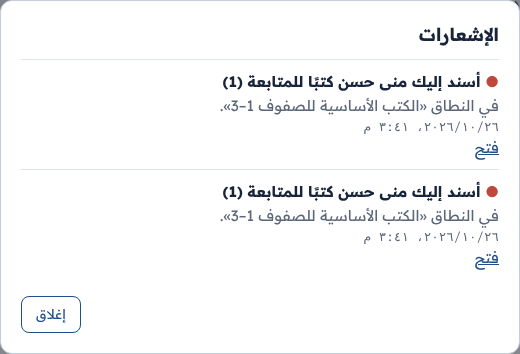

### مهامي (في هذه المؤسسة)

تعرض **«مهامي»** في القائمة (مع عدد الكتب المفتوحة) الكتب المسندة إليك في نطاقات المؤسسة: المتأخرة أولًا ثم حسب تاريخ الاستحقاق. غيّر **«الحالة»** مباشرة من القائمة، و**«عرض»** يبدّل بين لم تكتمل بعد والمكتملة والكل.

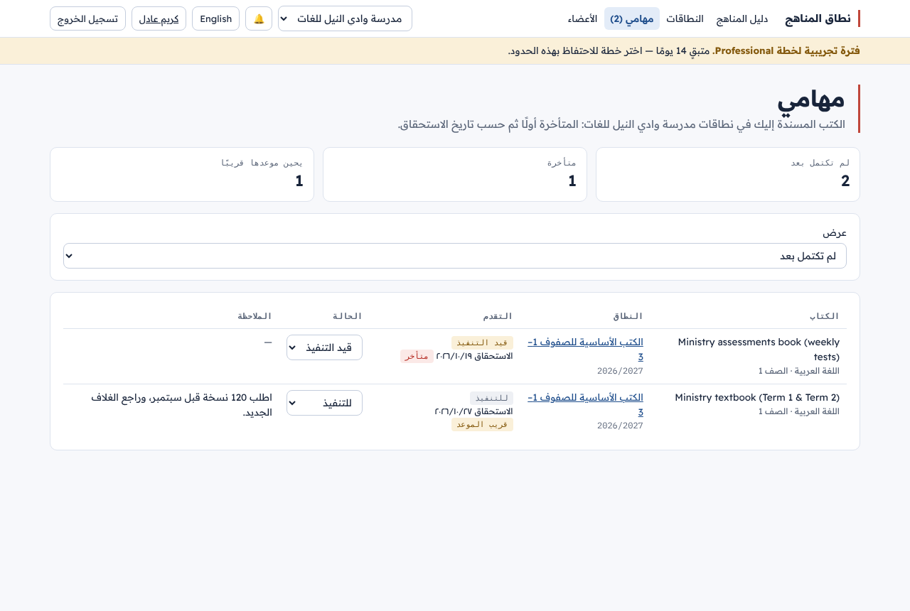

### مهامي في كل مؤسساتي

إن كنت عضوًا في أكثر من مؤسسة، فالرابط أعلى «مهامي» يفتح قائمة واحدة تجمعها، مع سطر يعدّ الكتب المفتوحة في كل مؤسسة. تُستثنى المؤسسات الموقوفة، أو التي تفرض التحقق بخطوتين ولم تفعّله بعد، مع ملاحظة بذلك.

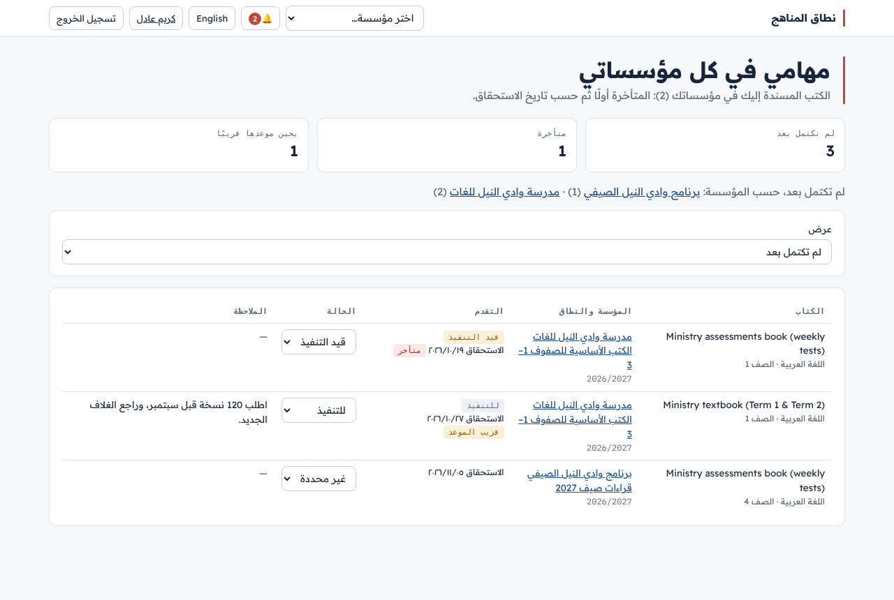

### أكثر من مؤسسة

قائمة المؤسسات في الشريط العلوي تنقلك بين مؤسساتك، و**«مؤسسة جديدة…»** تنشئ مؤسسة أخرى. وتعرض صفحة حسابك كل مؤسساتك.

## 8. الأعضاء والدعوات

تعرض صفحة **«الأعضاء»** أعضاء المؤسسة: الدور، وهل يستخدم التحقق بخطوتين، وتاريخ الانضمام.

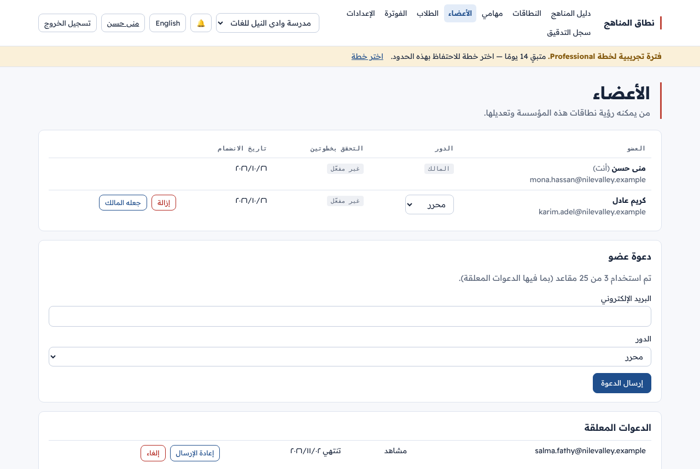

- **«دعوة عضو»**: اكتب البريد واختر الدور ثم **«إرسال الدعوة»**. تُحسب المقاعد بعدد الأعضاء والدعوات المعلقة، ويعرض السطر أعلى النموذج المستخدم من مقاعد خطتك.
- **«الدعوات المعلقة»** يمكن **«إعادة الإرسال»** أو **«إلغاء»** أيٍّ منها. تنتهي صلاحية الدعوة بعد 7 أيام.
- يغيّر المالك والمسؤولون **«الدور»** من القائمة (يدير المسؤولون المحررين والمشاهدين)، أو **«إزالة»** العضو. ويستطيع العضو **«مغادرة»** المؤسسة.
- **«جعله المالك»** (للمالك فقط) ينقل الملكية بعد كتابة كلمة مرورك، فتصبح مسؤولًا وتفقد التحكم في الفوترة.

### قبول الدعوة

يفتح رابط الدعوة في البريد صفحة توضح من دعاك وإلى أي مؤسسة وبأي دور. يكتب الشخص الجديد اسمه وكلمة مرور ثم **«إنشاء حساب والانضمام»**، ويكون بريده مؤكدًا لأن الدعوة أثبتته. أما من له حساب فيسجّل الدخول ويقبل الدعوة.

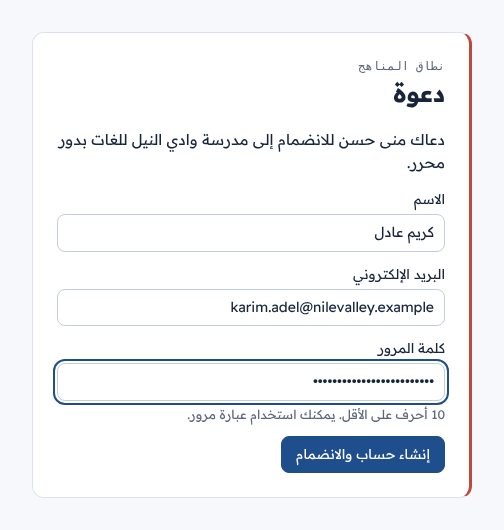

## 9. عام دراسي جديد: نقل النطاق

عندما تنشر المنصة دليل العام التالي (القسم 17)، يظهر في دليل المناهج شريط لكل نطاق ما زال على العام السابق، ويصل إشعار وبريد إلى المحررين.

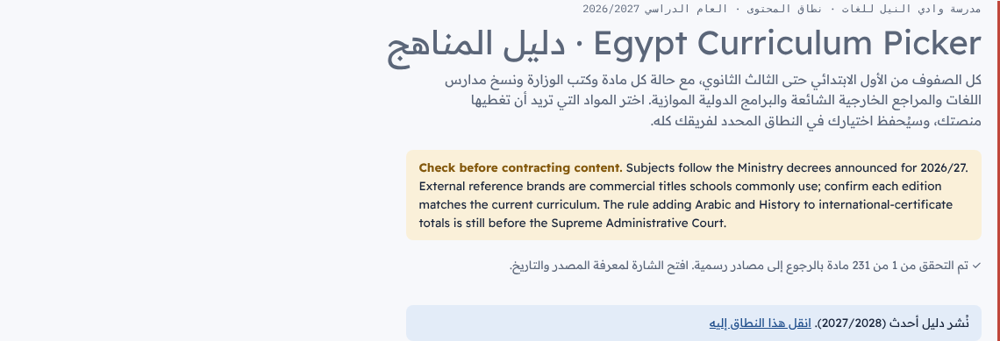

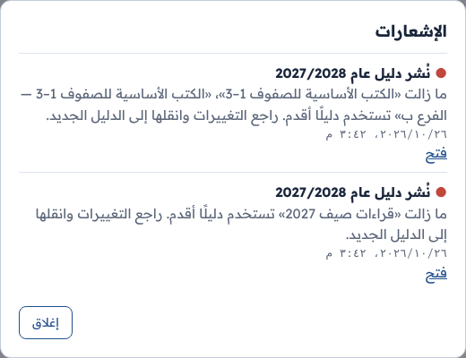

**«انقل هذا النطاق إليه»** (أو **«النقل إلى 2027/2028…»** من صفحة النطاقات) يعرض ما تغيّر قبل حفظ أي شيء:

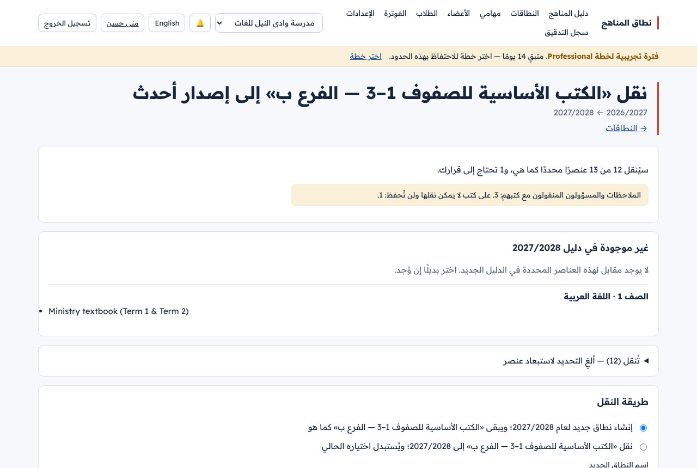

- **الملخص**: كم كتابًا يُنقل كما هو، وكم يحتاج إلى قرارك، وكم ملاحظة وإسنادًا يُنقل مع كتبه.
- **«غير موجودة في دليل 2027/2028»**: كتب ليس لها مقابل في العام الجديد. حدّد بديلًا إن ظهر («جديد في 2027/2028 — أضِف بدلًا منه»).
- **التغييرات في المواد التي تغطيها** و**الجديد فيها**: الكتب التي تغيّر اسمها، والمواد التي تغيّرت، والعناوين الجديدة.
- **«تُنقل»**: افتحها وألغِ تحديد ما لا تريد نقله.
- **«طريقة النقل»**: أنشئ نطاقًا جديدًا للعام الجديد مع الإبقاء على القديم (واختر اسمه)، أو انقل هذا النطاق نفسه إلى العام الجديد فيُستبدل اختياره. وإن لم تتسع خطتك لنطاق إضافي فلا يُعرض إلا النقل.
- **«نقل»** يحفظ ذلك ويفتح النتيجة في دليل المناهج.

## 10. الفوترة

تعرض صفحة **«الفوترة»** (للمالك والمسؤولين، والمالك وحده يغيّر الخطة) الخطة الحالية واستخدام هذا الشهر والخطط والفواتير.

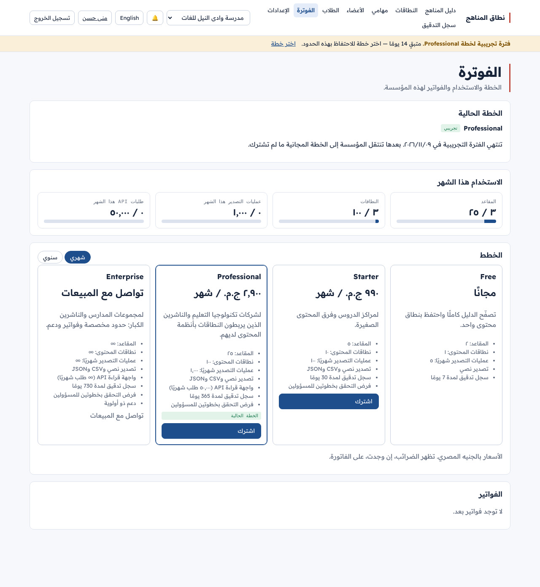

- **«الخطة الحالية»**: الخطة وحالتها (تجريبي، نشط، متأخر السداد، مجاني) وما يحدث بعد ذلك، مثل تاريخ انتهاء التجربة أو التجديد.
- **«الاستخدام هذا الشهر»**: المقاعد والنطاقات وعمليات التصدير وطلبات API مقارنةً بحدود الخطة.
- **«الخطط»**: اختر شهري أو سنوي، ثم:
  - **«اشترك»** أثناء التجربة أو على الخطة المجانية، بما في ذلك الخطة التي تجرّبها.
  - **«ترقية الآن»** لخطة أعلى بالدورة نفسها، وتدفع فاتورة بالتناسب لباقي الفترة.
  - **«التحويل عند التجديد»** لخطة أقل أو دورة فوترة أخرى.
  - **«الانتقال للمجانية في نهاية الفترة»** أو **«إلغاء الاشتراك»**: تحتفظ بخطتك حتى نهاية الفترة، ولا يُحذف شيء. و**«الإبقاء على اشتراكي»** يتراجع عن الإلغاء.
  - **«تواصل مع المبيعات»** لخطة Enterprise.
- **«فواتير مستحقة»** و**«الفواتير»**: للفاتورة المفتوحة زر **«ادفع»**، ولكل فاتورة رقمها ومبلغها وحالتها.

يفتح الاشتراك صفحة الدفع لدى مزوّد الدفع: Paymob في التشغيل الفعلي بعد ضبط مفاتيح الحساب، وعلى خادم الاختبار هذا صفحة الدفع التجريبية التي لا تنقل أي أموال:

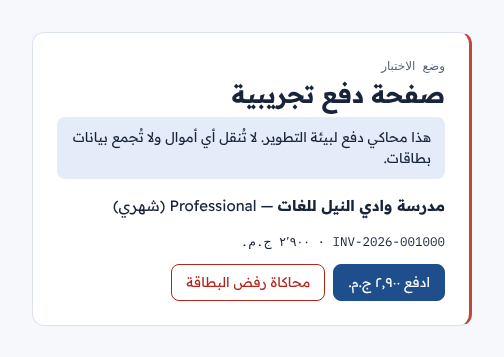

بعد الدفع تعود إلى الفوترة، فتنتظر الصفحة تأكيد المزوّد ثم تعرض **«تم استلام الدفع. شكرًا لك!»**، ويصل إيصال إلى بريد المالك.

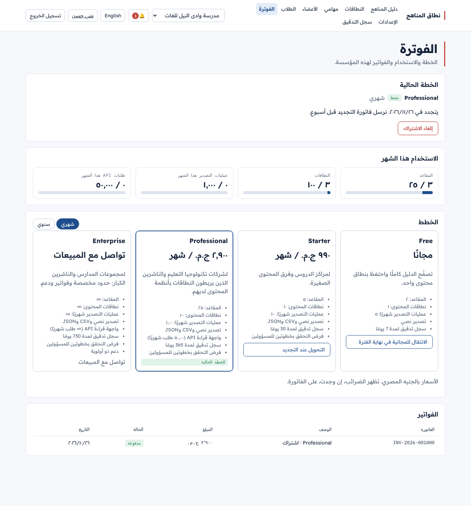

**التجديد.** قبل التجديد بأسبوع تصل فاتورة التجديد إلى بريد المالك. إن لم تُدفع حتى تاريخ التجديد تبقى الخطة نشطة لمهلة سداد مدتها 7 أيام، ويعرض الشريط العلوي **«تأخر السداد»** مع **«ادفع الآن»**. بعد المهلة تنتقل المؤسسة إلى الخطة المجانية دون حذف أي شيء. وقبل انتهاء التجربة بثلاثة أيام يصل تذكير إلى المالك.

## 11. الطلاب وبوابة الطلاب

تستطيع المدرسة إنشاء حسابات لطلابها. يسجّل الطالب الدخول برمز المدرسة واسم مستخدم وكلمة مرور، دون بريد إلكتروني، ويرى الكتب التي اختارتها المدرسة لصفه في النطاق الذي تحدده. تبقى بوابة الطلاب مغلقة حتى يفعّلها مسؤول المنصة للمدرسة (لا تتضمنها أي خطة حتى الآن)، وبعدها تظهر **«الطلاب»** في قائمة المالك والمسؤولين.

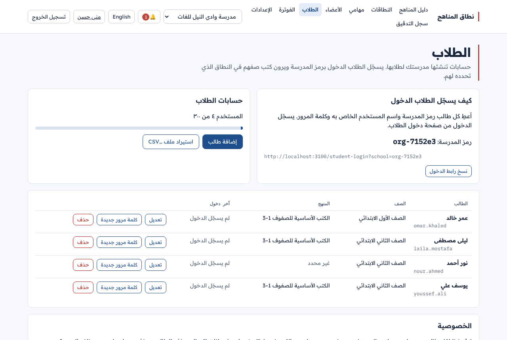

- **«كيف يسجّل الطلاب الدخول»**: رمز المدرسة، ورابط دخول فيه الرمز جاهزًا، و**«نسخ رابط الدخول»** لنسخه. على خادم الاختبار يبدأ الرابط بـ `http://localhost:3100`، وعلى الخادم الفعلي يظهر عنوان موقعكم. (اسم المدرسة التجريبية عربي، فأنشأ النظام لها رمزًا عامًا مثل `org-…`.)
- **«إضافة طالب»**: اسم مستخدم (من 3 إلى 40 حرفًا لاتينيًا أو رقمًا أو نقطة أو شرطة)، واسم الطالب، والصف، و**«المنهج»**: النطاق الذي يرى الطالب كتبه.

  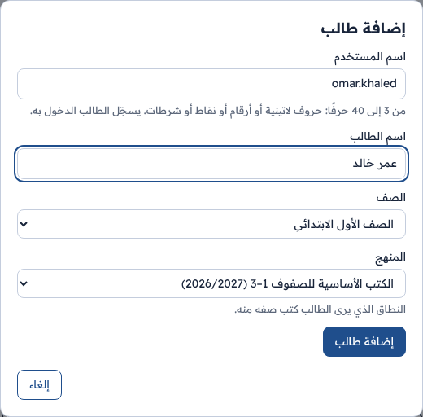

- تظهر كلمة المرور **مرة واحدة** مع رمز المدرسة. دوّنها أو اضغط **«تنزيل كلمات المرور (CSV)»**. وزر **«كلمة مرور جديدة»** في القائمة يعيّن كلمة جديدة ويُخرج الطالب من كل أجهزته.

  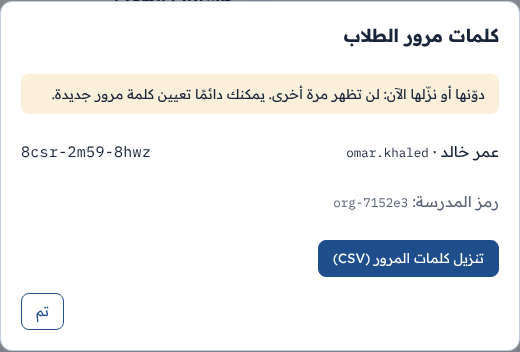

- **«استيراد ملف CSV…»** يضيف حتى 300 طالب من جدول بالأعمدة `username` و`name` و`grade` (من 1 إلى 12)، واختياريًا `scope` (اسم أحد نطاقاتك). في Excel احفظ الملف بصيغة «CSV UTF-8»، و**«تنزيل نموذج»** يعطيك الشكل المطلوب. يُفحص الملف أولًا وتُعرض المشكلات حسب رقم السطر، ولا يُستورد أي شيء حتى تختفي.

  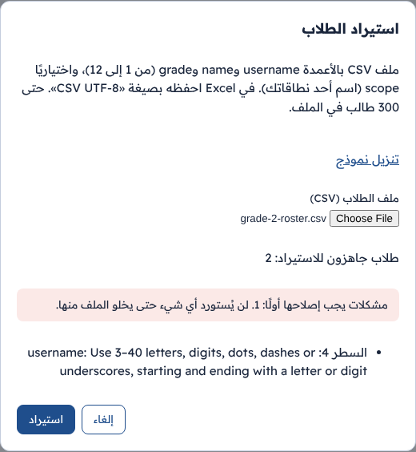

  نص المشكلة نفسها يأتي من الخادم وقد يظهر بالإنجليزية.

- **«تعديل»** يغيّر اسم الطالب أو صفه أو منهجه، و**«حذف»** يحذف الحساب نهائيًا.
- **«الخصوصية»**: لا يُحفظ لكل طالب سوى اسمه واسم المستخدم وصفه ومنهجه، ولا يرى موظفو المنصة سوى عدد الحسابات.

### بوابة الطلاب

يفتح الطالب رابط الدخول (أو **«طالب؟ سجّل الدخول بحساب مدرستك»** من صفحة الدخول) ويكتب رمز المدرسة واسم المستخدم وكلمة المرور.

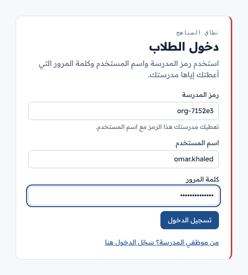

يرى الطالب **«منهجي»**: كتب صفه مرتبة كما في دليل المناهج، مع نوع كل كتاب. ويستطيع تغيير كلمة مروره والتبديل إلى الإنجليزية. لا يستطيع الطالب تغيير القائمة، وتطلب منه الصفحة سؤال معلمه إن كان هناك ما ينقص.

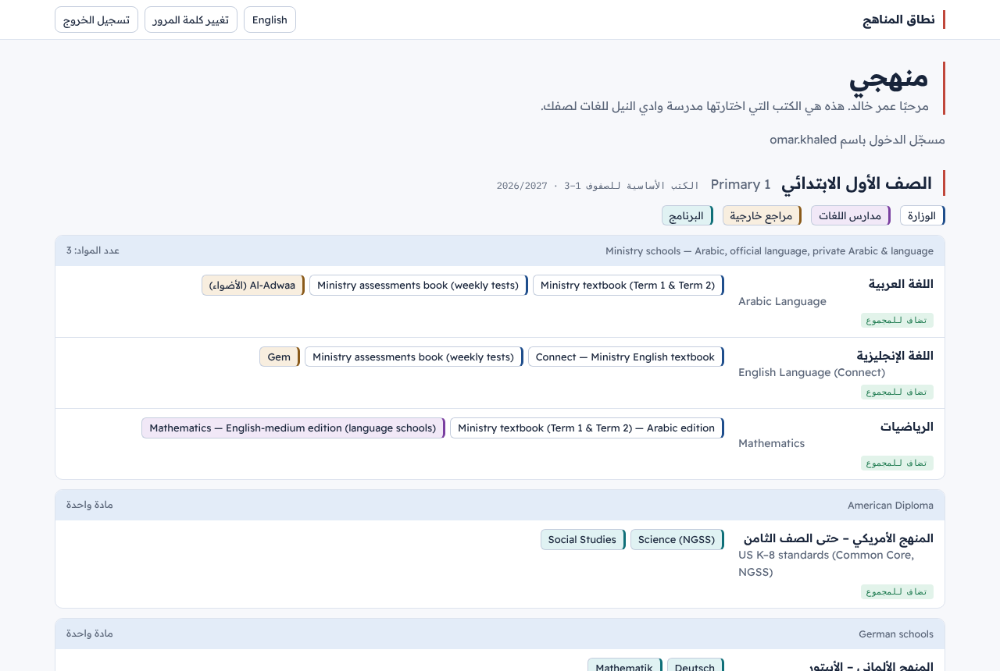

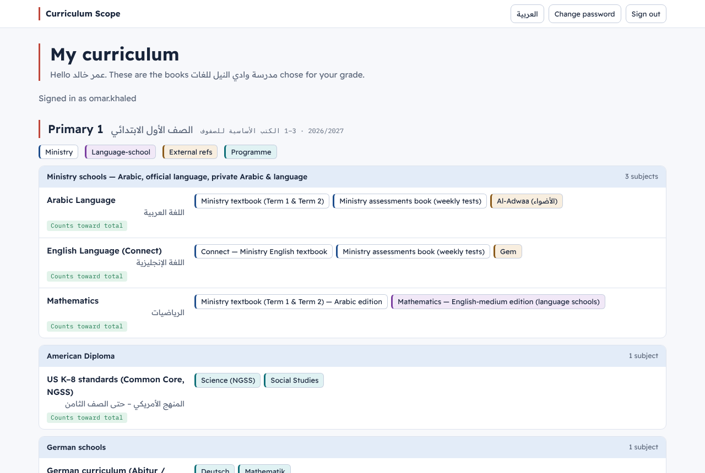

## 12. إعدادات المؤسسة: مفاتيح API وإشعارات الأنظمة ووصول الدعم

صفحة **«الإعدادات»** (للمالك والمسؤولين):

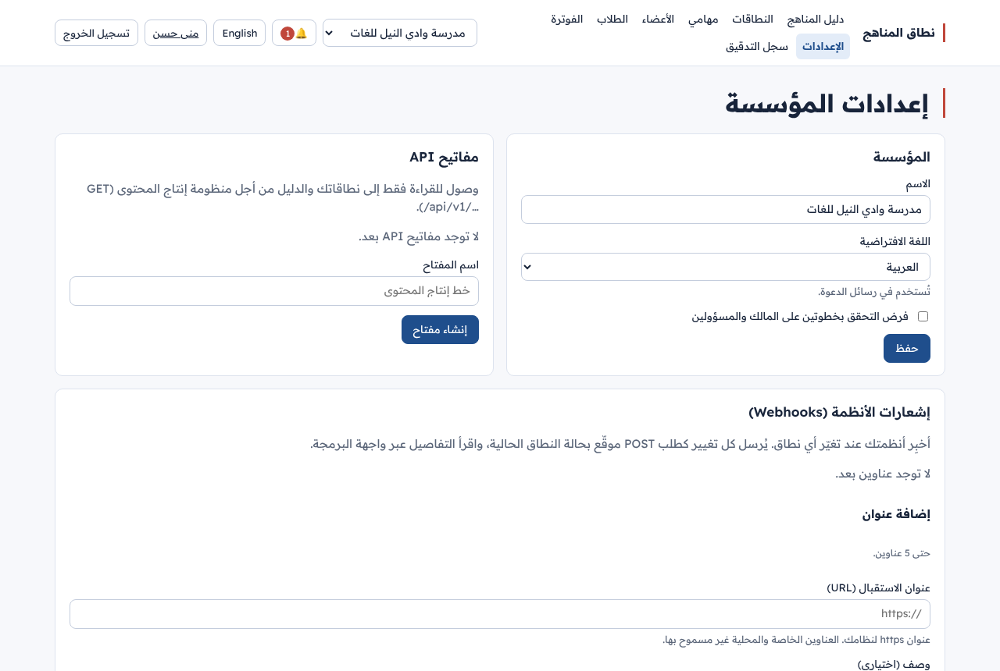

### المؤسسة

**«الاسم»** و**«اللغة الافتراضية»** التي تُستخدم في رسائل الدعوة. و**«فرض التحقق بخطوتين على المالك والمسؤولين»** (خطة Starter أو أعلى) يُلزمهم بتفعيله قبل فتح المؤسسة.

### مفاتيح API (خطة Professional أو أعلى)

تتيح مفاتيح API قراءة نطاقاتك والدليل فقط، لأنظمة المحتوى لديك (`GET /api/v1/scopes` و`/api/v1/scopes/:id` و`/api/v1/catalog/versions`). اكتب اسمًا واضغط **«إنشاء مفتاح»**. يظهر المفتاح **مرة واحدة** فقط، فانسخه حينها.

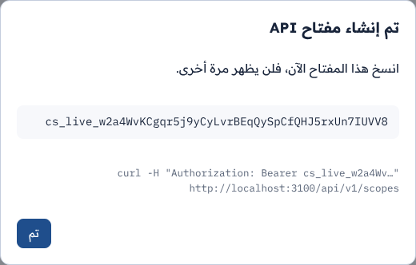

تعرض القائمة بداية كل مفتاح وآخر استخدام له، مع زر لإلغائه. التفاصيل في `docs/API_DOCUMENTATION.md`.

### إشعارات الأنظمة (Webhooks، مع واجهة API)

تُخبر إشعارات الأنظمة أنظمتك عند تغيّر أي نطاق، فيُرسل كل تغيير إلى عنوانك كطلب POST موقّع. أضف حتى 5 عناوين: عنوان **https** لنظامك (لا تُقبل العناوين الخاصة والمحلية)، ووصفًا اختياريًا، والأحداث المطلوبة: إنشاء نطاق، أو تغيير اسمه أو وصفه، أو حذفه، أو إضافة كتب أو إزالتها، أو تغيير الملاحظات والمسؤولين والحالة وتواريخ الاستحقاق.

يظهر سر التوقيع مرة واحدة، ويتحقق نظامك به من ترويسة `X-CurriculumScope-Signature` في كل طلب قبل الوثوق به.

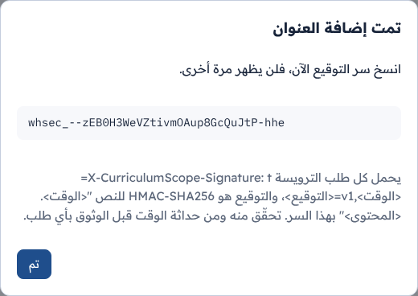

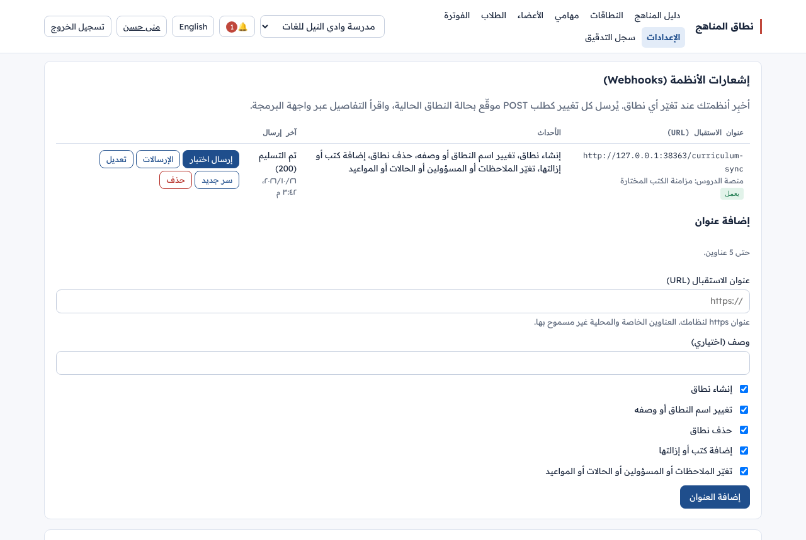

عنوان المثال محلي (`http://127.0.0.1:…`) ولا يقبله إلا خادم الاختبار. لكل عنوان:

- **«إرسال اختبار»** يرسل حدثًا تجريبيًا.
- **«الإرسالات»** تعرض ما أُرسل ونتيجته.
- **«تعديل»** يغيّر العنوان أو الأحداث أو يوقف العنوان.
- **«سر جديد»** يستبدل سر التوقيع.
- **«حذف»** يحذف العنوان.

تُعاد محاولة الإرسال الفاشل، ويُوقف العنوان الذي يفشل باستمرار مع الإشارة إلى ذلك.

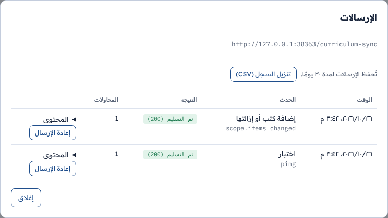

في **«الإرسالات»** افتح **«المحتوى»** لترى ما أُرسل، و**«إعادة الإرسال»** لتكرار إرسال ما. **«تنزيل السجل (CSV)»** يحفظ الإرسالات المحفوظة، وتُحفظ الإرسالات 30 يومًا.

### وصول فريق الدعم (للمالك)

**لا يستطيع فريق دعم المنصة رؤية نطاقاتك** إلا إذا سمح المالك بذلك من هنا، مع سبب ومدة (مثل 24 ساعة). تُسجَّل كل مشاهدة من فريق الدعم في سجل التدقيق لديك، ويمكن إنهاء الوصول مبكرًا.

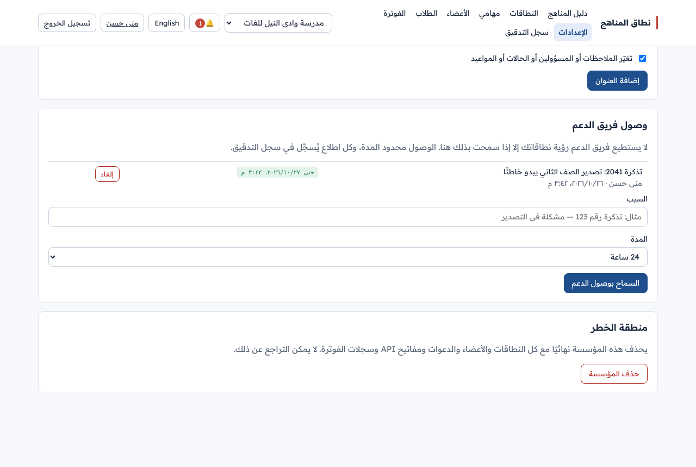

### منطقة الخطر (للمالك)

**«حذف المؤسسة»** يحذفها نهائيًا بكل نطاقاتها وأعضائها ودعواتها ومفاتيحها وسجلات فوترتها، ويُطلب للتأكيد كتابة اسم المؤسسة وكلمة مرورك.

## 13. سجل التدقيق

**«سجل التدقيق»** (للمالك والمسؤولين) هو سجل الأمان والتغييرات في المؤسسة: تسجيلات الدخول، وتغييرات النطاقات، والأعضاء، والدعوات، والفوترة، ومفاتيح API، وإشعارات الأنظمة، ووصول الدعم، والطلاب. تحدد الخطة مدة حفظ السجل (من 7 إلى 730 يومًا). **«تصفية»** حسب بداية اسم الإجراء، مثل `scope.` أو `member.` أو `billing`، و**«إدخالات أقدم»** تحمّل المزيد.

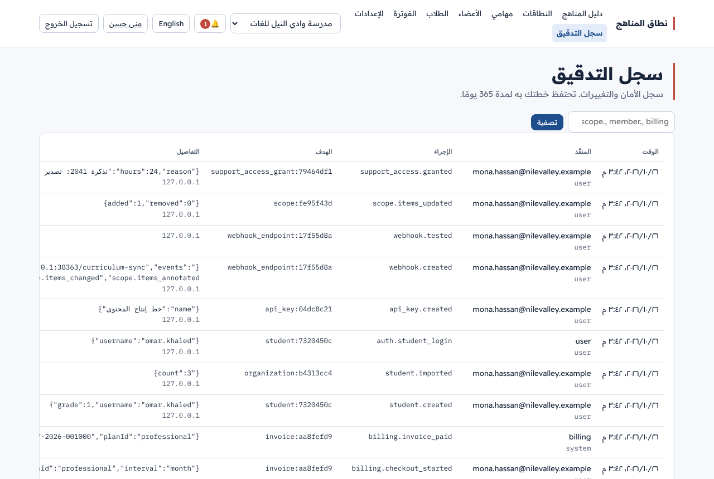

يعرض عمود **«المنفّذ»** بريد الشخص. ليس للطلاب بريد، فيظهر دخول الطالب باسم «user» ويكون اسم المستخدم في **«التفاصيل»**. أسماء الإجراءات رموز تقنية بالإنجليزية، والإدخالات العريضة تُمرَّر أفقيًا داخل الجدول.

## 14. حسابك

اضغط اسمك في الشريط العلوي.

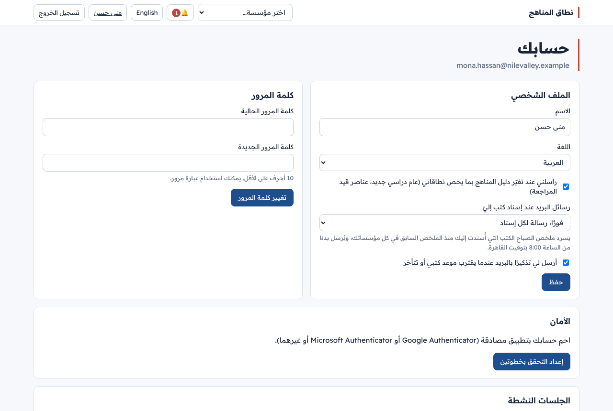

- **«الملف الشخصي»**: اسمك ولغتك وخيارات البريد:
  - البريد عند تغيّر دليل المناهج لنطاقاتك؛
  - البريد عند إسناد كتب إليك: **«فورًا، رسالة لكل إسناد»** أو **«ملخص واحد كل صباح»** (من الساعة 8:00 بتوقيت القاهرة، لكل مؤسساتك) أو **«لا شيء (إشعارات داخل التطبيق فقط)»**؛
  - تذكير عند اقتراب موعد كتبك أو تأخرها.
- **«كلمة المرور»**: غيّرها بكتابة كلمة المرور الحالية، فتُخرج جلساتك الأخرى.
- **«الأمان»**: **«إعداد التحقق بخطوتين»**. امسح رمز QR بتطبيق مصادقة (Google Authenticator أو Microsoft Authenticator أو غيرهما) أو اكتب المفتاح، ثم اكتب الرمز المكوّن من 6 أرقام. احفظ رموز الاسترداد التي تظهر بعدها، فكل رمز يعمل مرة واحدة إن فقدت هاتفك. ويجب على مسؤولي المنصة إبقاء التحقق بخطوتين مفعّلًا.

  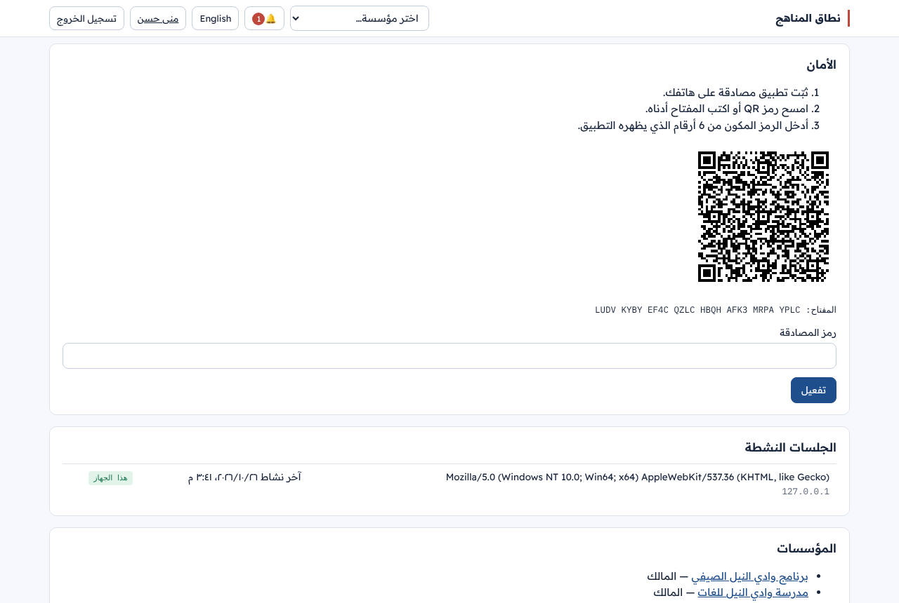

- **«الجلسات النشطة»**: الأجهزة التي سجّلت منها الدخول، مع تسجيل الخروج من كل منها، و**«تسجيل الخروج من كل الجلسات الأخرى»**.
- **«المؤسسات»**: مؤسساتك ودورك فيها، و**«إنشاء مؤسسة»**.
- **«بياناتك»**: **«تنزيل بياناتي (JSON)»** (ملفك وعضوياتك وجلساتك وإشعاراتك ونشاطك الأخير)، و**«حذف حسابي»** بعد نقل ملكية المؤسسات التي تملكها أو حذفها.

## 15. الإنجليزية والهاتف

زر **English** في الشريط العلوي يحوّل الواجهة كلها إلى الإنجليزية من اليسار إلى اليمين، و**العربية** يعيدها. يُحفظ اختيارك في حسابك. وتحتفظ مواد الدليل باسميها العربي والإنجليزي، وتُعلَّم العناوين الإنجليزية داخل الواجهة العربية لتقرأها برامج قراءة الشاشة بالإنجليزية وتظهر بترتيبها الصحيح.

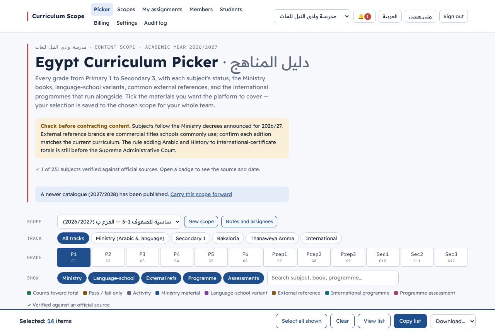

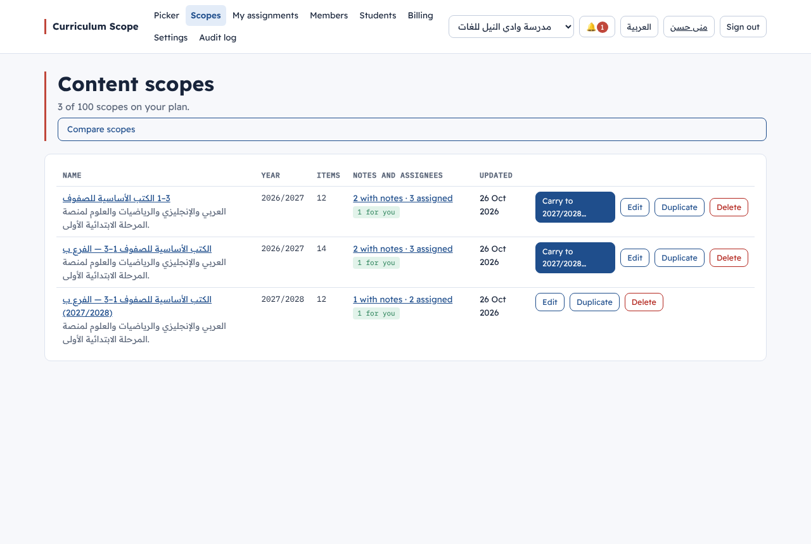

على الهاتف تتراص عناصر الصفحة: تلتف القائمة في أعلى الصفحة ولا تبقى ثابتة أثناء التمرير، وتظهر كتب كل مادة تحت اسمها، ويبقى شريط الاختيار أسفل الشاشة.

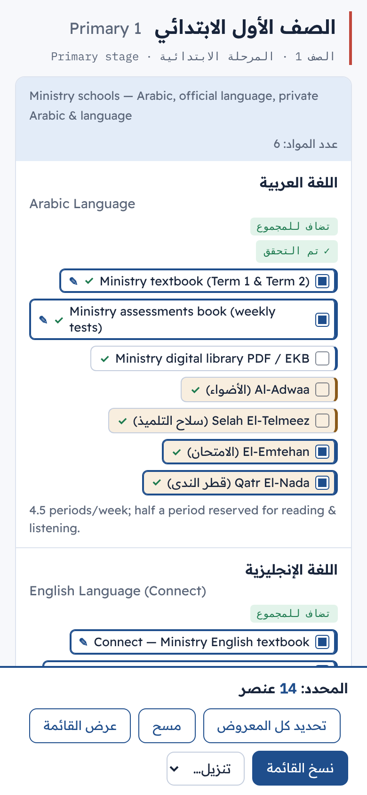

## 16. رسائل البريد التي يرسلها النظام

كل الرسائل نصية وبلغة صاحب الحساب، والروابط إلى بيانات الآخرين تتطلب تسجيل الدخول دائمًا. أمثلة من المدرسة التجريبية (الروابط مختصرة):

**تأكيد البريد الإلكتروني** (عند التسجيل، والرابط صالح 48 ساعة)

> مرحبًا منى حسن،\
> يرجى تأكيد بريدك الإلكتروني لتفعيل حسابك:\
> `https://…/verify-email?token=…`\
> تنتهي صلاحية الرابط خلال 48 ساعة. إذا لم تقم بالتسجيل فتجاهل هذه الرسالة.\
> — منصة نطاق المناهج

**الدعوة** (صالحة 7 أيام)

> دعاك منى حسن للانضمام إلى مدرسة وادي النيل للغات بدور محرر.\
> لقبول الدعوة:\
> `https://…/invite?token=…`\
> تنتهي صلاحية الدعوة خلال 7 أيام.\
> — منصة نطاق المناهج

**إسناد كتاب إليك** (فورًا، أو في ملخص واحد كل صباح، حسب اختيارك)

> أسند إليك منى حسن كتابًا للمتابعة في النطاق «الكتب الأساسية للصفوف 1–3» (مدرسة وادي النيل للغات):\
> • Ministry assessments book (weekly tests)\
> اطّلع على كتبك وملاحظاتها ومواعيدها:\
> `https://…/org/…/scopes/…/items?show=mine`\
> تصلك هذه الرسالة لأن كتبًا أُسندت إليك. يمكنك إيقاف هذه الرسائل من إعدادات حسابك: `https://…/account`\
> — منصة نطاق المناهج

**كتب اقترب موعدها أو تأخرت** (تذكير واحد لكل كتاب عند اقتراب موعده وآخر عند تأخره، ويُرسل من الساعة 8:00 بتوقيت القاهرة)

> مرحبًا كريم عادل،\
> تحتاج هذه الكتب المسندة إليك في مدرسة وادي النيل للغات إلى متابعة:\
> **متأخرة عن موعدها (1):**\
> • Ministry assessments book (weekly tests) — «الكتب الأساسية للصفوف 1–3»، كان موعده ١٩ أكتوبر ٢٠٢٦\
> **يحين موعدها قريبًا (1):**\
> • Ministry textbook (Term 1 & Term 2) — «الكتب الأساسية للصفوف 1–3»، موعده غدًا\
> حدّث حالتها أو اطّلع على كل كتبك:\
> `https://…/org/…/assignments`\
> تصلك هذه الرسالة لأن كتبًا لها مواعيد أُسندت إليك. يصلك تذكير واحد لكل كتاب عند اقتراب موعده وآخر عند تأخره. يمكنك إيقاف هذه الرسائل من إعدادات حسابك: `https://…/account`\
> — منصة نطاق المناهج

**نشر دليل عام جديد** (إلى المحررين والمسؤولين والمالك)

> أصبح دليل عام 2027/2028 (مناهج مصر من الروضة حتى الثانوي — العام الدراسي 2027/2028) متاحًا في منصة نطاق المناهج. ما زالت نطاقات المحتوى التالية في مدرسة وادي النيل للغات تستخدم دليلًا أقدم:\
> • الكتب الأساسية للصفوف 1–3\
> • الكتب الأساسية للصفوف 1–3 — الفرع ب\
> راجع التغييرات لكل نطاق (كتب غير موجودة، طبعات جديدة، تغييرات في المواد) وانقله إلى الدليل الجديد:\
> `https://…/org/…/scopes`\
> تصلك هذه الرسالة لأنك تستطيع تعديل النطاقات في مدرسة وادي النيل للغات. يمكنك إيقاف هذه الرسائل من إعدادات حسابك: `https://…/account`\
> — منصة نطاق المناهج

**تم استلام الدفع**

> استلمنا ٢٬٩٠٠٫٠٠ ج.م. للفاتورة INV-2026-001000 (مدرسة وادي النيل للغات). شكرًا لك.\
> — منصة نطاق المناهج

ويرسل النظام أيضًا:

- روابط إعادة تعيين كلمة المرور؛
- إشعارًا عند تغيير كلمة المرور؛
- إشعارًا عند محاولة التسجيل ببريدك؛
- نقل الملكية؛
- مواد الدليل التي وُضعت قيد المراجعة؛
- الملخص اليومي للكتب المسندة؛
- تذكير انتهاء التجربة وانتهاءها؛
- فواتير التجديد، والدفع الفاشل، والتجديد المتأخر؛
- انتهاء الاشتراك.

## 17. إدارة المنصة

يدير مسؤولو المنصة الخدمة، وتحل قائمتهم محل قائمة المؤسسة، ويجب أن يسجّلوا الدخول بالتحقق بخطوتين. **ولا يرون** نطاقات العملاء أو ملاحظاتهم أو طلابهم، إلا أثناء وصول دعم منحه مالك المؤسسة، وعندها تُسجَّل كل مشاهدة في سجل تدقيق تلك المؤسسة.

### نظرة عامة على المنصة

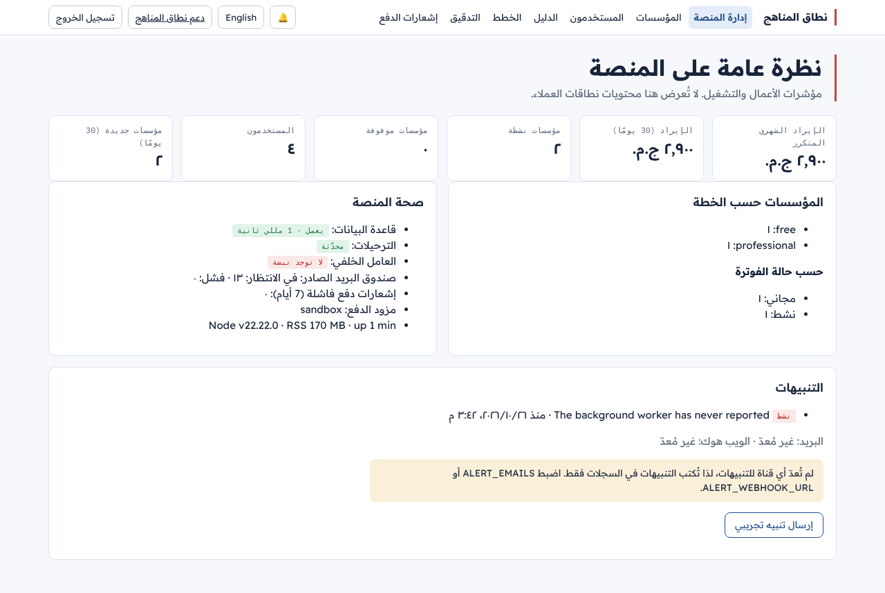

تعرض **«نظرة عامة على المنصة»**:

- الإيراد الشهري المتكرر وإيراد آخر 30 يومًا؛
- المؤسسات النشطة والموقوفة والجديدة، وعدد المستخدمين؛
- المؤسسات حسب الخطة وحسب حالة الفوترة؛
- **«صحة المنصة»**: قاعدة البيانات، والترحيلات، والعامل الخلفي، وصندوق البريد الصادر، والإشعارات الفاشلة، ومزوّد الدفع، والخادم؛
- **«التنبيهات»**: التنبيهات النشطة والمحلولة مؤخرًا، وقنوات التنبيه المضبوطة (البريد وwebhook)، و**«إرسال تنبيه تجريبي»**.

عمل خادم المثال دون العامل الخلفي، لذلك تظهر **«لا توجد نبضة»** وينتظر البريد في الصندوق، ويظهر تنبيه نصه بالإنجليزية لأن نصوص التنبيهات تأتي من الخادم. أما الخادم الفعلي فيشغّل العامل الخلفي وتُضبط له قناة تنبيه.

### المؤسسات

**«بحث»** يجد المؤسسة، واسمها يفتحها:

- **«إيقاف المؤسسة»** / **«استعادة المؤسسة»**، مع سبب يُسجَّل في سجل التدقيق.
- **«الاشتراك»** و**«تعيين الخطة يدويًا»**: الخطة والحالة ونهاية الفترة (مفتوحة للعقود)، مع استثناءات اختيارية للمقاعد و**«حسابات الطلاب (استثناء)»**. الرقم في حسابات الطلاب يفعّل بوابة الطلاب لتلك المدرسة حتى هذا العدد.
- **«تسجيل كمدفوعة»** للفواتير المفتوحة التي دُفعت خارج النظام (تحويل بنكي أو شيك).
- **«الأعضاء»** وعدد النطاقات وحسابات الطلاب.
- **«وصول فريق الدعم»**: مع منح فعّال من المالك يظهر **«عرض نطاقات العميل»** (مع التسجيل في سجل التدقيق)، ودونه: «لا يوجد منح فعّال. بيانات العميل غير متاحة.»
- سجل تدقيق المؤسسة.

### المستخدمون

ابحث عن المستخدمين، و**«إيقاف»** الحساب أو **«استعادة»** (مع سبب)، و**«فك القفل»** عن حساب أقفلته محاولات الدخول الخاطئة.

### الدليل

للدليل إصدار لكل عام دراسي. محتوى الإصدار المنشور للقراءة فقط، لكن يمكن تحديث علامات التحقق فيه. ولتجهيز العام التالي أنشئ **مسودة** منسوخة من إصدار موجود:

يعرض الإصدار صفوفه وموادها، مع **«تم التحقق: …»** لعدد المواد والعناصر التي تم التحقق منها، وقائمة **«عرض»** (كل المواد، لم يتم التحقق، تم التحقق، تحتاج مراجعة). وفي المسودة يمكن إضافة المواد والعناصر وتعديلها.

**«التحقق…»** على المادة (أو **«التحقق من الصف كله…»**، أو **«تحقق»** على العنصر) يسجّل نتيجة المراجعة على مصدر رسمي:

- **«تم التحقق»**، مع المصدر (إلزامي) ورابط اختياري، ويمكن تطبيقه على عناصر المادة أيضًا؛
- **«يحتاج مراجعة»**، مع ملاحظة عامة إلزامية؛
- **«لم يتم التحقق»**.

يرى العملاء الحالة والتاريخ والمصدر والملاحظة، لا اسم من راجع. وتعديل محتوى عنصر في المسودة يلغي علامة التحقق الخاصة به.

**«تنزيل جدول البيانات (CSV)»** و**«رفع جدول البيانات المعدّل…»** يتيحان العمل نفسه في Excel، وفي المسودة يمكن به أيضًا تصحيح المحتوى وإضافة عناصر (بترك `material_id` فارغًا). احفظ بصيغة «CSV UTF-8». تُعرض كل التغييرات قبل تطبيقها، ولا يُحفظ شيء ما دامت في الجدول مشكلات.

**«نشر»** يتيح المسودة لكل العملاء ويجمّد محتواها، ثم يُبلَّغ العملاء الذين ما زالت نطاقاتهم على عام سابق (القسم 9). و**«أرشفة»** تُبقي الإصدار القديم مقروءًا للنطاقات الموجودة وتمنع اختياره للنطاقات الجديدة.

### الخطط

عدّل لكل خطة اسمها والسعر الشهري والسنوي (بالقرش: 99000 تعني 990 ج.م.) والحدود والمزايا (بصيغة JSON، و`null` تعني بلا حد) وتفعيلها. يسري التعديل على الفواتير الجديدة، ومنها فاتورة التجديد التالية للاشتراك، وتبقى الفواتير الصادرة بمبالغها. يعرض النظام الوصف المترجم للخطط الأربع ما دام وصفها الإنجليزي الأصلي لم يتغيّر، فإن عدّلته ظهر نصك كما كتبته.

### التدقيق وإشعارات الدفع

**«التدقيق»** هو سجل تدقيق المنصة كلها، مع التصفية حسب الإجراء أو بريد المنفّذ أو المؤسسة.

**«إشعارات الدفع»** تعرض إشعارات مزوّد الدفع (تمت معالجته، تم تجاهله، فشل) لمراجعة المدفوعات.

## 18. حدود وملاحظات مهمة

- **حدود الخطة** تُطبَّق أثناء العمل. عند بلوغ حد (المقاعد، النطاقات، التصدير، الطلاب، طلبات API) توضح الرسالة الحد المعني، وترشد المالك إلى صفحة الفوترة.
- **التحقق من الدليل**: تجري مراجعة مواد الدليل على المصادر الرسمية. وإلى أن تحمل المادة علامة **✓ تم التحقق**، راجعها على قرار الوزارة أو الناشر قبل التعاقد على المحتوى.
- **الدفع**: تستخدم صور هذا الدليل صفحة الدفع التجريبية. يتم الدفع الفعلي عبر Paymob بعد ضبط مفاتيح الحساب.
- **الطلاب**: يفعّل مسؤول المنصة البوابة لكل مدرسة على حدة.
- **التكاملات**: واجهة القراءة API وإشعارات الأنظمة ضمن خطة Professional وما فوقها. الدخول الموحد (Google وMicrosoft) غير متاح بعد.
- **اللغة**: محتوى الدليل (عناوين الكتب وكثير من الملاحظات) ورسائل التحقق القادمة من الخادم ونصوص التنبيهات التشغيلية تظهر بالإنجليزية. ولم يراجع مترجم محترف النص العربي للواجهة ولهذا الدليل بعد.

---

## عن هذا الدليل

تُلتقط الصور بالأمر `npm run docs:screenshots:ar` (الإعداد `playwright.guide-ar.config.ts`، والبرنامج `tests/e2e/user-guide.spec.ts`، وهو نفسه الذي يلتقط صور الدليل الإنجليزي بالأمر `npm run docs:screenshots`). يشغّل البرنامج خادم الاختبار نفسه بقاعدة بيانات جديدة، ثم يبني المدرسة التجريبية من الواجهة العربية كما يفعل أصحابها: التسجيل، والنطاقات، والأعضاء، والملاحظات، وعام دراسي جديد، والدفع، والطلاب، والإعدادات، ولوحة الإدارة، ويحفظ كل شاشة في `docs/user-guide/images-ar/`. كل تسميات الأزرار والحقول يأخذها من قاموس الواجهة نفسه، فإن تغيّر نص في الواجهة تبعه البرنامج. أعد تشغيله بعد أي تغيير في الواجهة وتأكد أن الصور ما زالت تطابق النص. يفشل التشغيل إن توقفت خطوة عن العمل، أو إن كان محتوى نافذة أعرض من النافذة.

