# Midad: user guide

Midad lets a school, publisher or ed-tech team choose which books
and programmes of the Egyptian curriculum (Primary 1 to Secondary 3) its
platform covers. The team keeps those choices together in named lists called
**content scopes**. It adds notes, assigns books to colleagues with due dates,
and carries each list forward when a new academic year's catalogue is
published. A school can also give its students accounts, organize classes
with their teachers, set daily homework and online tests, and keep a gradebook;
each student sees their own work, marks and books.

This guide walks through every part of the system, screen by screen, in the
order a school meets them. It also covers the platform administrator's
console. The whole interface works in English and Arabic (see
[section 16](#16-arabic-and-phones)).

> **About the screenshots.** They were taken from a demo school on a test
> server. The people, school, emails and addresses are invented. Payments use
> the test-mode checkout (no real money). A few details differ from a live
> server, and the captions point them out. To retake every screenshot after a
> change to the interface, run `npm run docs:screenshots`; see
> [About this guide](#about-this-guide).

## Contents

1. [Plans and creating an account](#1-plans-and-creating-an-account)
2. [Signing in](#2-signing-in)
3. [Roles: who can do what](#3-roles-who-can-do-what)
4. [The picker: choosing books](#4-the-picker-choosing-books)
5. [Scopes: list, duplicate, compare](#5-scopes-list-duplicate-compare)
6. [Notes, assignees, statuses and due dates](#6-notes-assignees-statuses-and-due-dates)
7. [Notifications and My assignments](#7-notifications-and-my-assignments)
8. [Members and invitations](#8-members-and-invitations)
9. [A new academic year: carrying a scope forward](#9-a-new-academic-year-carrying-a-scope-forward)
10. [Billing](#10-billing)
11. [Students and the student portal](#11-students-and-the-student-portal)
12. [Classes, homework, tests and grades](#12-classes-homework-tests-and-grades)
13. [Organization settings: API keys, webhooks, support access](#13-organization-settings-api-keys-webhooks-support-access)
14. [Audit log](#14-audit-log)
15. [Your account](#15-your-account)
16. [Arabic and phones](#16-arabic-and-phones)
17. [Emails the system sends](#17-emails-the-system-sends)
18. [Platform administration](#18-platform-administration)
19. [Limits and things to know](#19-limits-and-things-to-know)

---

## 1. Plans and creating an account

### Pricing

The **Pricing** page (`/pricing`) is open to everyone. Every plan has the same
curriculum catalogue; plans differ in team size, number of scopes, exports and
integrations. Switch between **Monthly** and **Yearly** prices at the top.

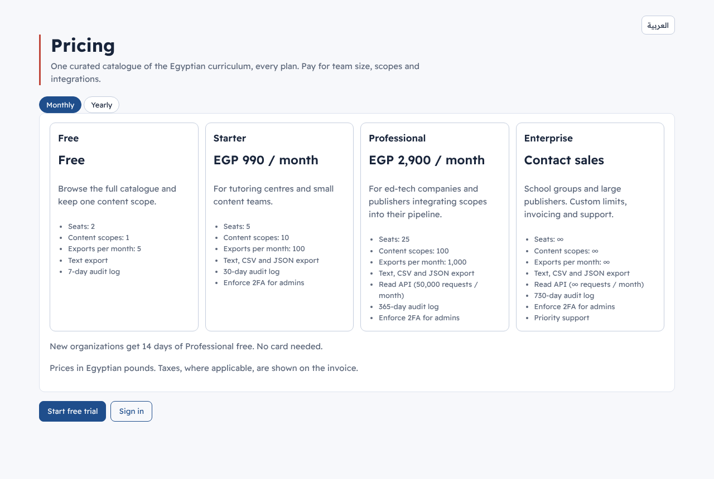

| Plan | Price | Seats | Scopes | Exports a month | Also |
|---|---|---|---|---|---|
| Free | free | 2 | 1 | 5 | Text export, 7-day audit log |
| Starter | EGP 990 a month | 5 | 10 | 100 | CSV and JSON export, 30-day audit log, two-factor rule for admins |
| Professional | EGP 2,900 a month | 25 | 100 | 1,000 | Read API (50,000 requests a month) and webhooks, 365-day audit log |
| Enterprise | contact sales | no limit | no limit | no limit | Priority support, 730-day audit log, invoicing |

Prices are in Egyptian pounds; any tax is shown on the invoice. A platform
administrator can change prices (section 18); changes apply to new invoices
only.

### Creating an account

Click **Start free trial** (or **Create an account** on the sign-in page).
Enter your name, email, a password of at least 10 characters, and your
organization's name: your company, school or team.

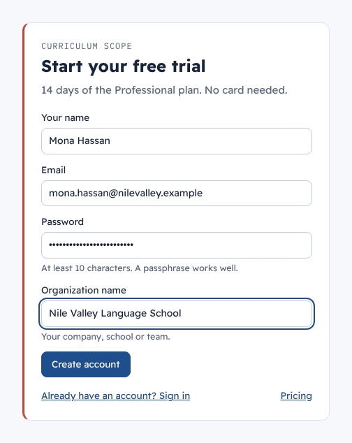

A new organization gets **14 days of the Professional plan** with no card.
After **Create account**, the system emails a confirmation link (it expires in
48 hours):

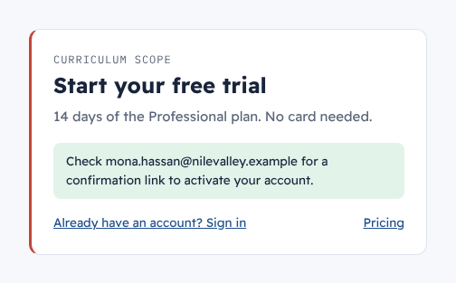

Opening the link confirms the address:

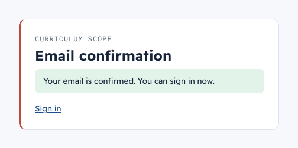

People invited by a colleague do not use this form; they accept the
invitation instead (section 8).

## 2. Signing in

Sign in with your email and password at `/login`.

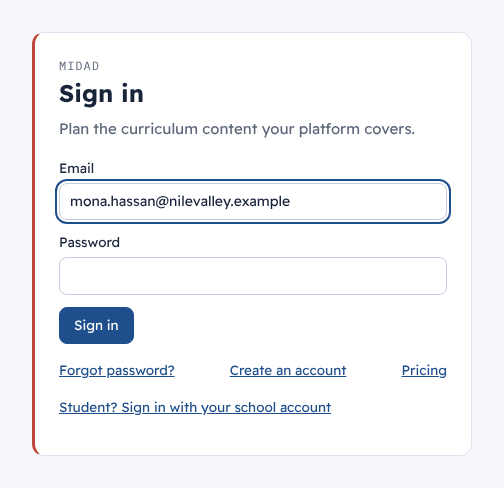

- **Forgot password?** emails a link to choose a new password. The link works
  once and expires in an hour. Changing the password signs out your other
  sessions.

  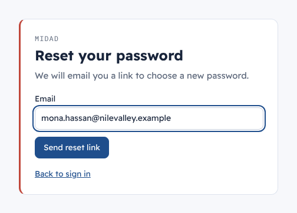

  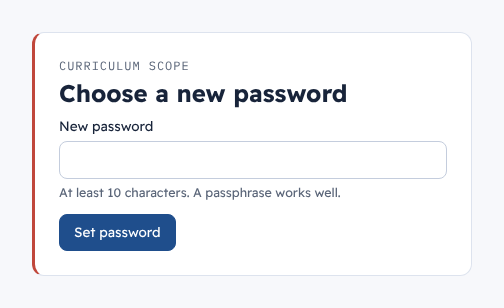

- **Two-factor authentication.** If you turned it on (section 15), or your
  organization requires it for owners and admins, the next page asks for the
  6-digit code from your authenticator app. If you lost your phone, use one
  of your recovery codes instead.

  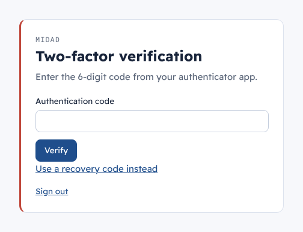

- **Students** have their own sign-in page, linked at the bottom
  (section 11).

After several wrong passwords the account is locked for a while; a platform
administrator can unlock it (section 18).

## 3. Roles: who can do what

Everyone in an organization has one role. The **Members** page lists them.

| Role | Can |
|---|---|
| **Owner** | Everything, including billing, transferring ownership, support access and deleting the organization. One per organization. |
| **Admin** | Manage editors and viewers, invitations, students, settings, API keys and webhooks; read the audit log and billing. |
| **Editor** | Create, edit, duplicate, carry forward and delete scopes; choose books; write notes and assign books. |
| **Viewer** | Read and export scopes, notes and assignments. Write their own teaching plans ([section 5](#teaching-plans)); cannot change anything else. |

The menu shows only what your role can use. Owners and admins see
**Students** and **Classes** (when the student portal is on), **Billing**,
**Settings** and **Audit log**; editors and viewers see **Picker**, **Scopes**,
**My assignments** and **Members**. Whatever their role, a member added to a
class as a teacher also sees **Classes** with the classes they teach
([section 12](#12-classes-homework-tests-and-grades)).

## 4. The picker: choosing books

The picker is the main screen, opened by **Picker** in the menu. It shows the
whole catalogue for the scope's academic year, grade by grade. A tick on a book
adds it to the scope you have selected, for everyone in your organization.

### Your first scope

A new organization has no scopes yet, so the picker starts with a prompt:

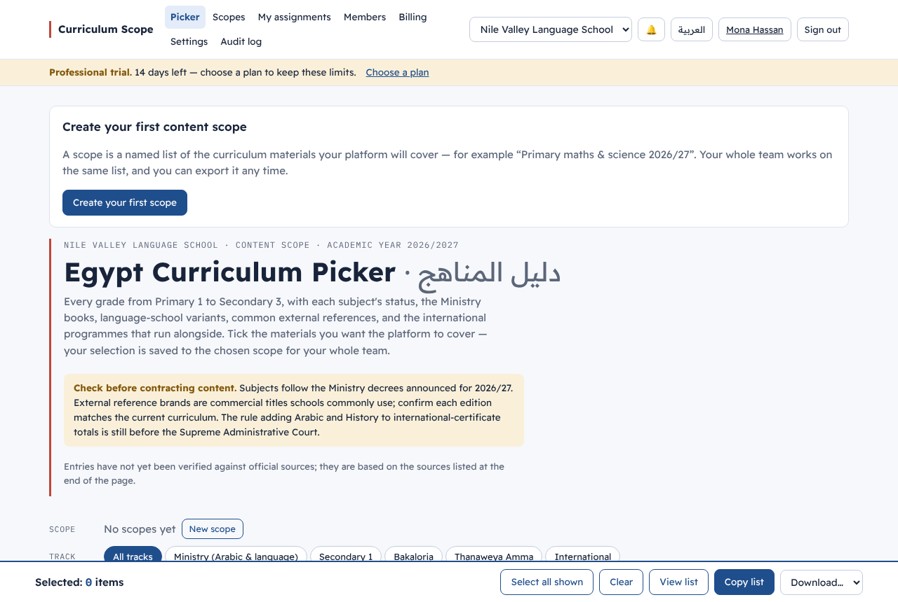

The yellow trial bar under the menu counts the trial's remaining days; its
**Choose a plan** link opens Billing.

**Create your first scope** (or **New scope** later) asks for a name, an
optional description and the catalogue year:

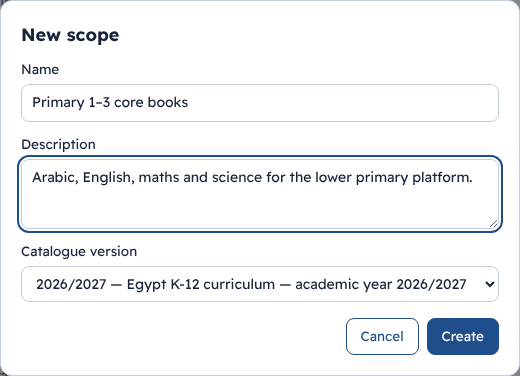

### Filters

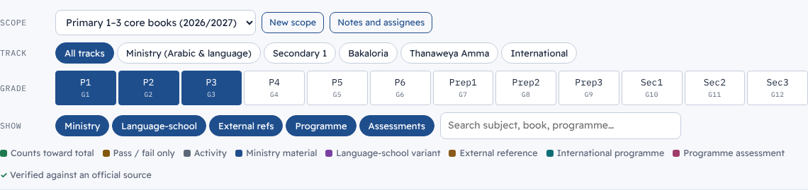

- **Scope**: the list you are editing. **New scope** creates another;
  **Notes and assignees** opens the notes page for this scope (section 6).
- **Track**: Ministry (Arabic and language schools), Secondary 1, Bakaloria,
  Thanaweya Amma, International, or all.
- **Grade**: P1–P6, Prep 1–3, Sec 1–3. Click several to show several grades;
  click a pressed grade again to hide it.
- **Show**: which kinds of books are listed: Ministry, Language-school,
  External references, Programme, Assessments.
- **Search** finds a subject, book or programme by name.
- The **colour key** explains the colours: a subject's status (counts toward
  the total, pass/fail only, activity) and each kind of book.

### Choosing books

Each subject shows its English and Arabic names, its status, and its books.
Click a book to add it; click again to remove it. The bar at the bottom shows
**Saved** after each change and counts the selected items.

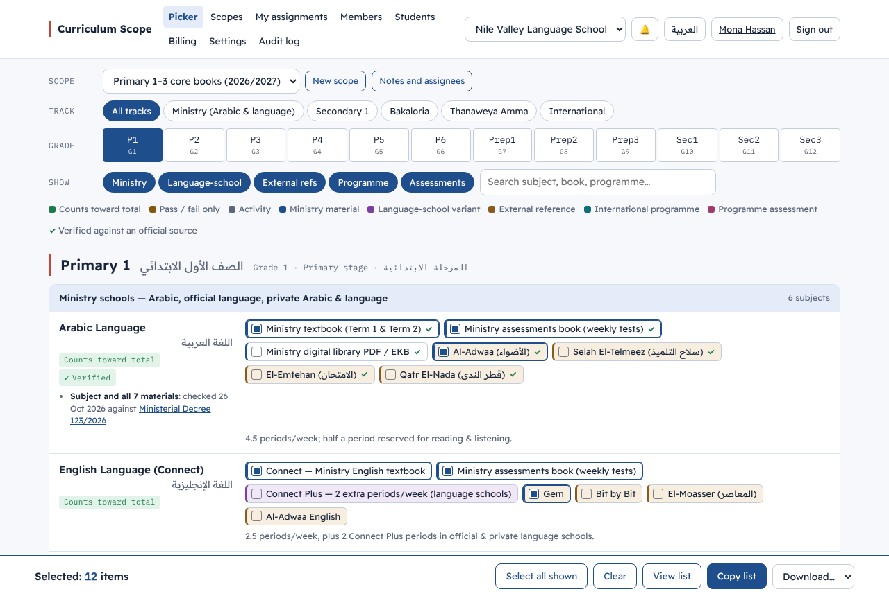

- **✓ Verified.** A green tick means a platform administrator checked the
  entry against an official source (a ministerial decree, a publisher's
  page). Open the subject's **Verified** badge to see the source and the date
  it was checked. Above the filters, a line says how many subjects are
  verified so far. Entries without a tick come from the sources listed at the
  end of the page; check them before contracting content.
- **✎** on a book means it has a note, an assignee, a status or a due date
  (section 6). Removing such a book asks for confirmation, because its note
  and assignment are removed with it.
- **Select all shown** adds every book currently listed (after filters);
  **Clear** empties the scope after confirmation.

### Your list, copied or downloaded

**View list** shows the selection as plain text, grouped by grade and
subject. **Copy list** copies that text. **Download…** saves the scope as
**TXT**, **CSV** or **JSON**. CSV and JSON need the Starter plan or above, and
every download counts toward the plan's monthly exports. CSV and JSON include
each book's verification, note, assignee, status and due date.

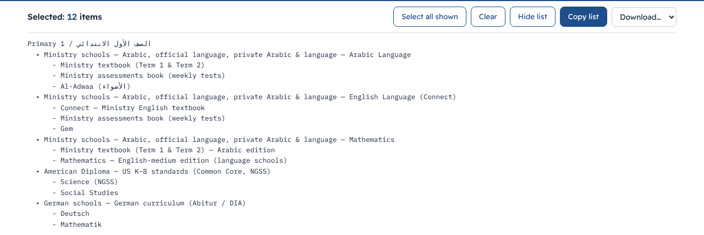

### Viewers

Viewers see the same picker, but books cannot be clicked. The scope bar says
**Read-only: viewers cannot change selections**, and so does a message when a
viewer tries.

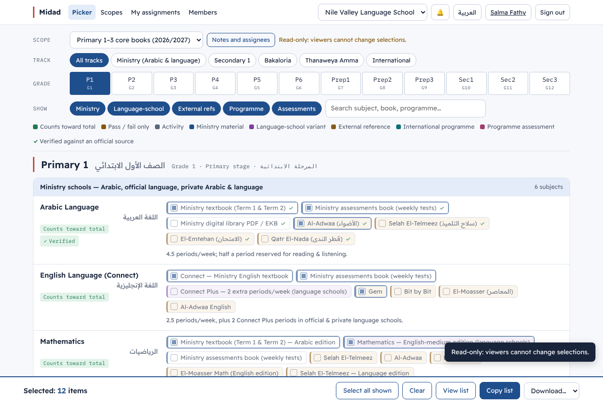

A scope above the plan's scope limit (after moving to a smaller plan) is also
read-only, with its own message.

## 5. Scopes: list, duplicate, compare

**Scopes** in the menu lists the organization's scopes and how many the plan
allows.

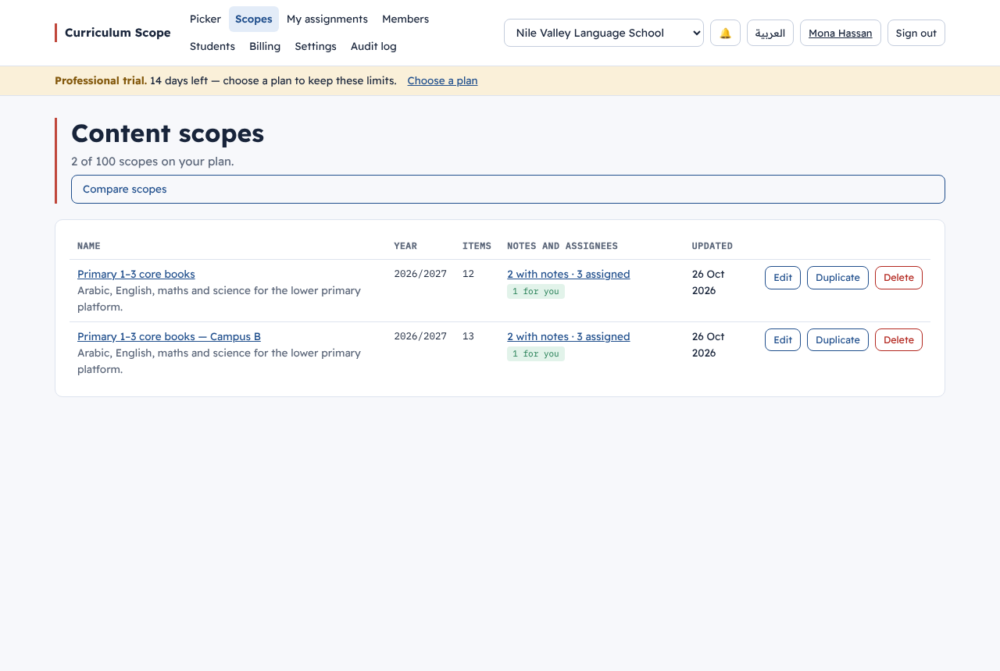

For each scope:

- The **name** opens it in the picker.
- **Notes and assignees** (the "2 with notes · 3 assigned" link) opens its
  notes page; "1 for you" counts the books assigned to you.
- **Edit** renames it or changes its description.
- **Duplicate** copies it, with its books, notes and assignments, under a new
  name (here "Primary 1–3 core books — Campus B", a second campus that swaps a
  few books). The copy opens in the picker.
- **Delete** removes it for everyone, after confirmation.
- When a newer catalogue exists, **Carry to 2027/2028…** appears
  (section 9).

### Comparing two scopes

**Compare scopes** shows which books each of two scopes includes, grade by
grade. The cards count the books only in the first, only in the second, and
in both. **Show only differences** hides books both scopes share. **Swap**
exchanges the two. **Download comparison (CSV)** saves it (Starter plan and
above; counts as an export).

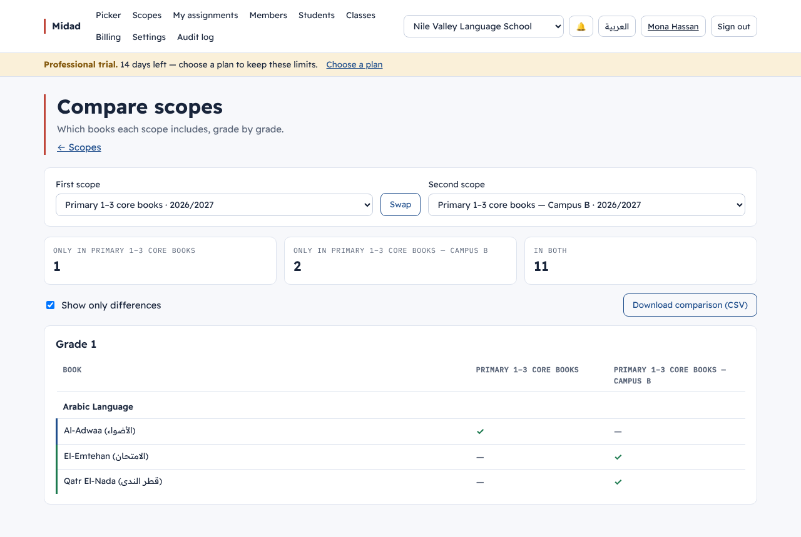

Scopes from different years can be compared. Books are then matched by
subject and title, and a book missing from one year's catalogue is marked.

### Teaching plans

On the scopes list, the link in the **Teaching plans** column (for example
**Plans: 2**), or **Teaching plans** on a class page, opens the scope's teaching
plans, by grade and subject. Any member can read and print
them and write new ones; a plan's author and the school's admins can change or
delete it. There are two kinds:

- a **lesson plan**: the topic and length of one lesson, the books, objectives,
  materials, a warm-up, the activities with their minutes, questions to ask,
  assessment, homework, support for students who struggle and more for those
  who finish early, and notes;
- a **pacing plan**: how a subject's curriculum is spread over the weeks of a
  term, from its first day, with the periods a week and, for each week, the
  units and lessons, objectives and notes. Each week shows its dates.

**New plan** asks the kind, the grade and the subject (those with books in the
scope), then **Start blank** or, when your school has AI requests, **Draft with
AI**:

- for a lesson plan, give the topic, if you like the lesson text, and the
  lesson's length;
- for a pacing plan, give the first day of the term, the number of teaching
  weeks, the periods a week and, if you like, the units and lessons to cover
  (for example the book's table of contents, one per line).

The draft opens in the editor, unsaved. Read and correct every part, then
**Save**; leaving the page discards it. Plans started from a draft are marked
"AI draft" in the list. AI can be wrong, and it does not know your school's
holidays: add them as notes on their weeks.

In the editor, lists take one item per line; **Add an activity** and **Add a
week** add rows, and each has its own **Remove** button. On a plan's page,
**Print** prints only the plan (choose "Save as PDF" in the print dialog for a
file).

## 6. Notes, assignees, statuses and due dates

Every selected book can carry a short note and be assigned to one member, with
a status (To do, In progress, Done) and an optional due date. Open the page
from **Notes and assignees** in the picker's scope bar or on the Scopes
page.

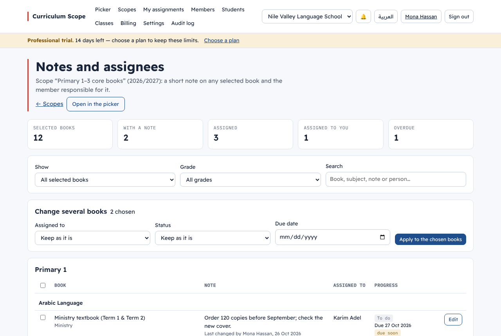

- The cards at the top count the selected books, those with a note, those
  assigned, those assigned to you, and those overdue.
- **Show** filters the list: all, assigned to me, with a note, assigned, not
  assigned, not done yet, overdue, done. **Grade** and **Search** narrow it
  further (search covers book, subject, note and person).
- **Progress** shows the status, the due date, and **due soon** (today or in
  the next two days) or **overdue** (after the due date, until the book is
  Done).
- Under each note: who changed it last, and when.

### Editing one book

**Edit** on a row opens the note and assignee dialog:

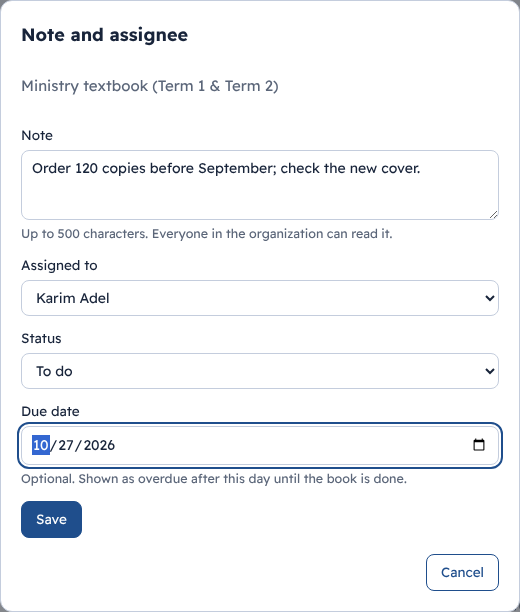

The note can be up to 500 characters, and everyone in the organization can
read it. **Assigned to** lists the organization's members. The due date is
optional; the date field follows your computer's regional format.

### Changing several books at once

Tick books in the list (or the box in a grade's header to tick every book
shown in that grade). Then choose in the **Change several books** bar what to
set: assignee, status and/or due date. **Keep as it is** leaves a field
unchanged. Click **Apply to the chosen books**.

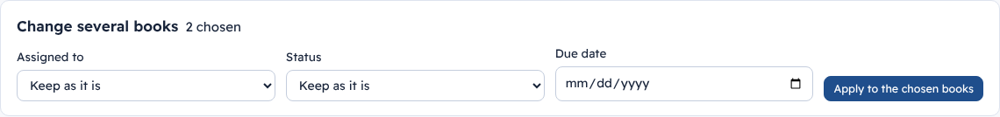

Assigning books notifies the assignee (section 7). Viewers can read this page
but not change it.

## 7. Notifications and My assignments

### Notifications

The bell in the top bar shows how many notifications are unread. It opens the
list; **Open** goes to the page concerned. Notifications arrive when books
are assigned to you, when books you follow are due soon or overdue, when a new
catalogue year is published for your scopes, and after a payment.

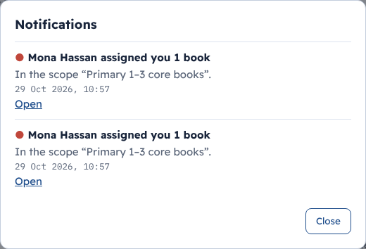

### My assignments (this organization)

**My assignments** in the menu (with a count of open books) lists the books
assigned to you in this organization's scopes: overdue first, then by due
date. Change a book's **Status** right in the list. **Show** switches between
Not done yet, Done and All.

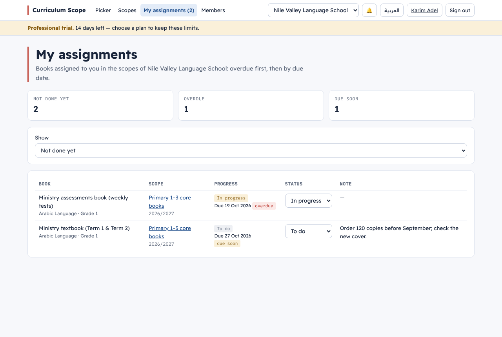

### My assignments in all my organizations

If you belong to several organizations, the link at the top of My assignments
opens one list across all of them, with a line counting the open books in
each. Organizations that are suspended, or that require two-factor
authentication you have not set up, are left out with a note.

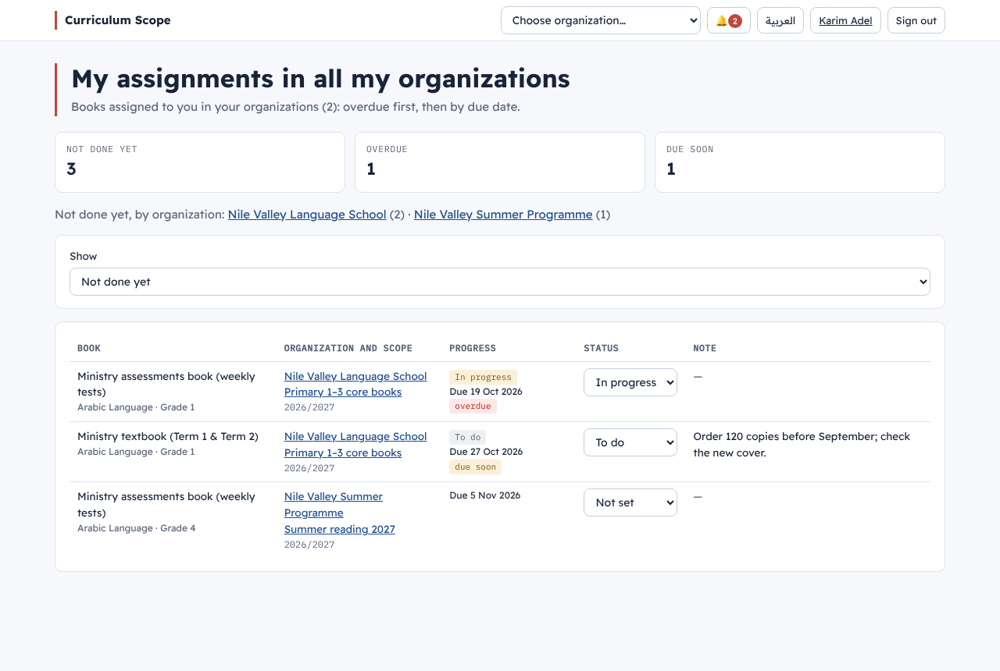

### Several organizations

The organization menu in the top bar switches between your organizations;
**New organization…** creates another. Your account page lists them all.

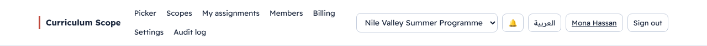

## 8. Members and invitations

**Members** lists who belongs to the organization: their role, whether they
use two-factor authentication, and when they joined.

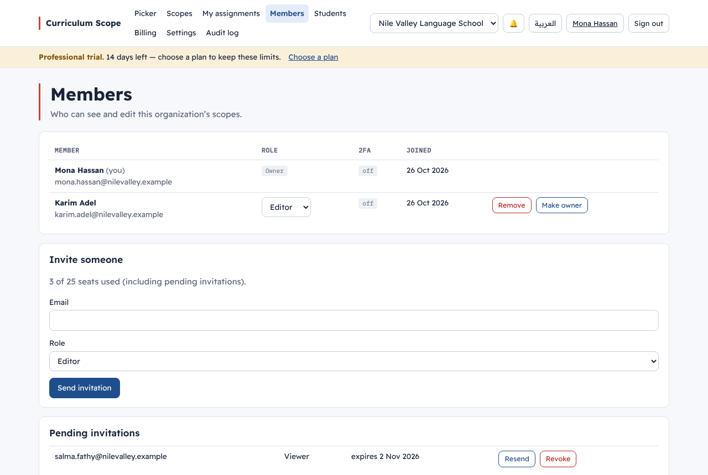

- **Invite someone**: enter an email and a role, then **Send invitation**. Seats
  count members plus pending invitations; the line above the form shows how
  many of the plan's seats are used.
- **Pending invitations** can be resent or revoked. An invitation expires
  after 7 days.
- Owners and admins change a member's **Role** in the list (admins manage
  editors and viewers) or **Remove** them. A member can **Leave**.
- **Make owner** (owner only) transfers ownership after you enter your
  password. You become an admin and lose billing control.

### Accepting an invitation

The invitation email links to a page that names who invited you, to which
organization, and with which role. Someone new enters their name and a
password and clicks **Create account and join**. The email is already
confirmed, because the invitation proved it. Someone with an account signs in
and accepts.

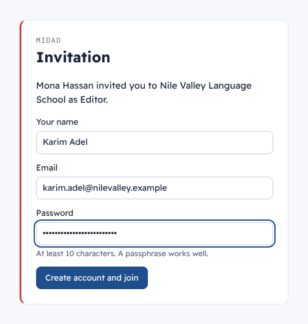

## 9. A new academic year: carrying a scope forward

When the platform publishes the next year's catalogue (section 18), each
scope still on the old year shows a banner in the picker. Editors also get a
notification and an email.

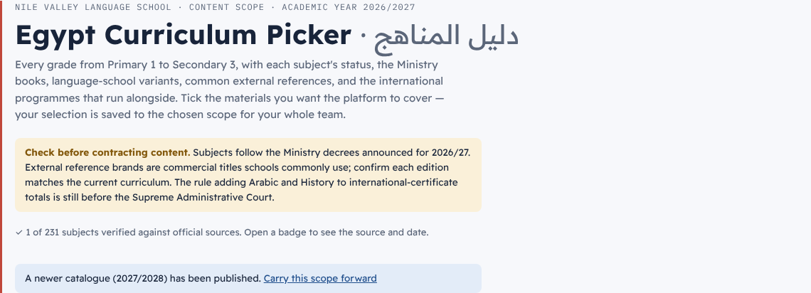

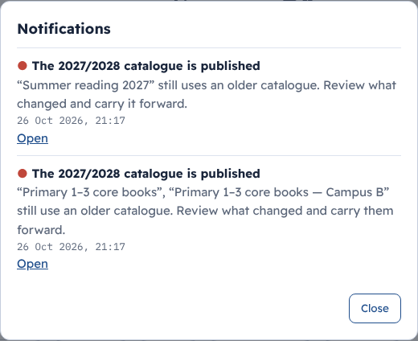

**Carry this scope forward** (or **Carry to 2027/2028…** on the Scopes page)
opens a review of what changed before anything is saved:

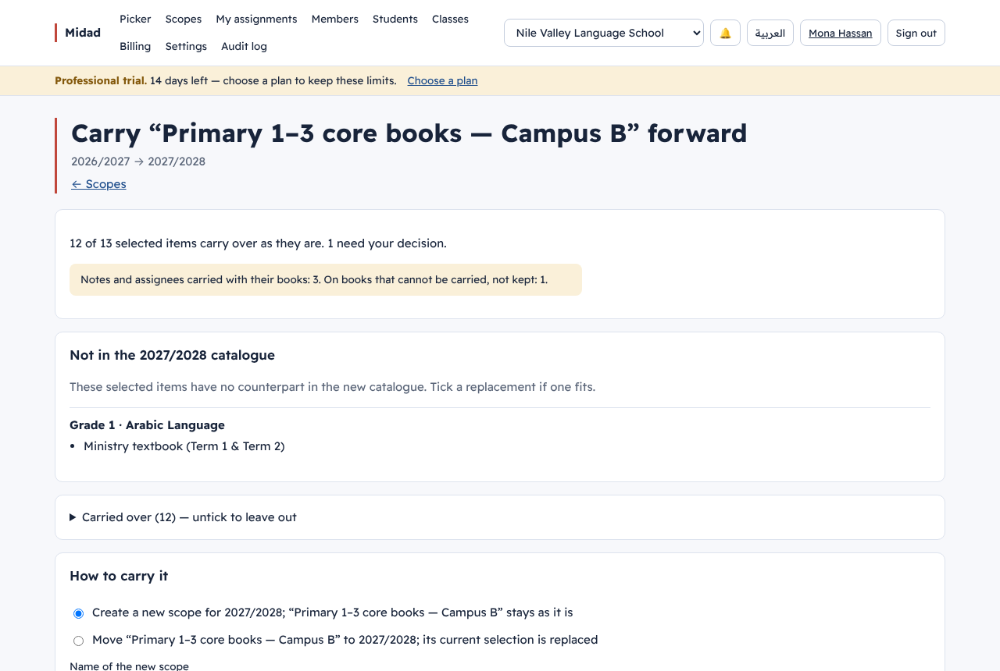

- **Summary**: how many selected books carry over as they are, how many need a
  decision, and how many notes and assignments go with their books.
- **Not in the new catalogue**: books with no counterpart next year. Tick a
  replacement when one is offered ("New in 2027/2028 — add instead").
- **Changes to subjects you cover** and **New in subjects you cover** list
  renamed books, changed subjects and new titles.
- **Carried over**: open it and untick anything to leave out.
- **How to carry it**: create a new scope for the new year and keep the old
  one (choose its name), or move this scope to the new year, replacing its
  selection. If the plan has no room for another scope, only moving is
  offered.
- **Carry forward** saves it and opens the result in the picker.

## 10. Billing

**Billing** (owners and admins; only the owner changes the plan) shows the
current plan, this month's usage, the plans, and invoices.

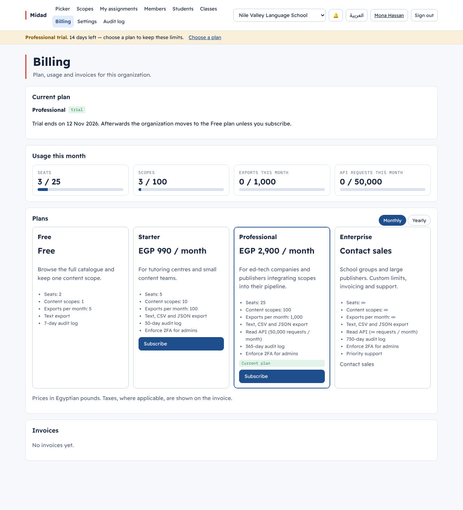

- **Current plan**: the plan, its state (trial, active, past due, free) and
  what happens next, such as the date a trial ends or the plan renews.
- **Usage this month**: seats, scopes, exports and API requests against the
  plan's limits.
- **Plans**: choose monthly or yearly, then:
  - **Subscribe** during a trial or on the Free plan. This includes the plan
    you are trialling.
  - **Upgrade now** for a higher plan on the same interval. You pay a
    prorated invoice for the rest of the period.
  - **Switch at renewal** for a lower plan or another interval.
  - **Move to Free at period end**, or **Cancel subscription**: you keep the
    plan until the period ends; nothing is deleted. **Keep my subscription**
    undoes it.
  - **Contact sales** for Enterprise.
- **Invoices to pay** and **Invoices**: open invoices have **Pay**; every
  invoice has its number, amount and status.

Subscribing opens the payment provider's checkout page. In production that is
Paymob, once its account keys are set. On this test server it is the sandbox
checkout, which moves no money:

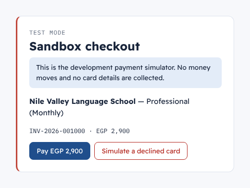

After payment you return to Billing, which waits for the provider's
confirmation and then shows **Payment received**. The owner also gets an email
receipt.

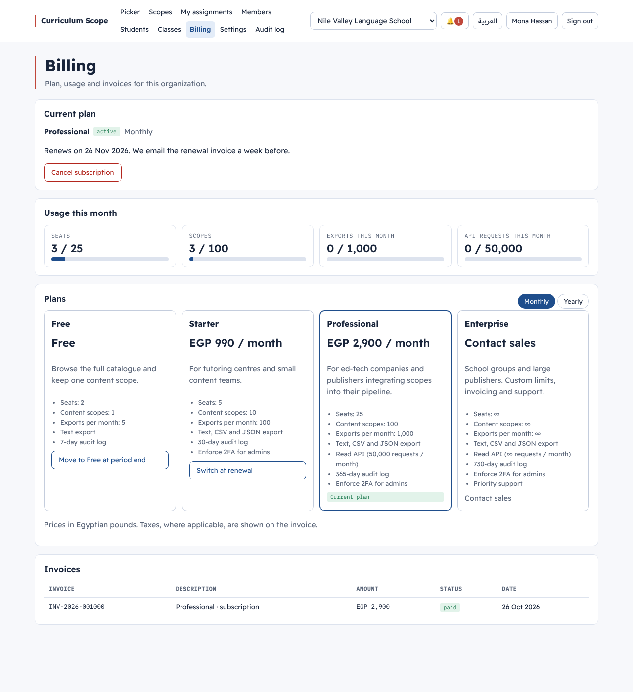

**Renewals.** A week before renewal, the owner gets the renewal invoice by
email. If it is not paid by the renewal date, the plan stays active for a
7-day grace period and the top bar shows **Payment overdue — Pay now**. After
that, the organization moves to the Free plan; nothing is deleted. Three days
before a trial ends, the owner gets a reminder.

## 11. Students and the student portal

Schools can create accounts for their students. A student signs in with the
school's code, a username and a password; no email is needed. They see the
books the school chose for their grade, in the scope the school assigns. The
student portal is off until a platform administrator turns it on for the
school (no plan includes it yet). After that, **Students** appears in the menu
of owners and admins.

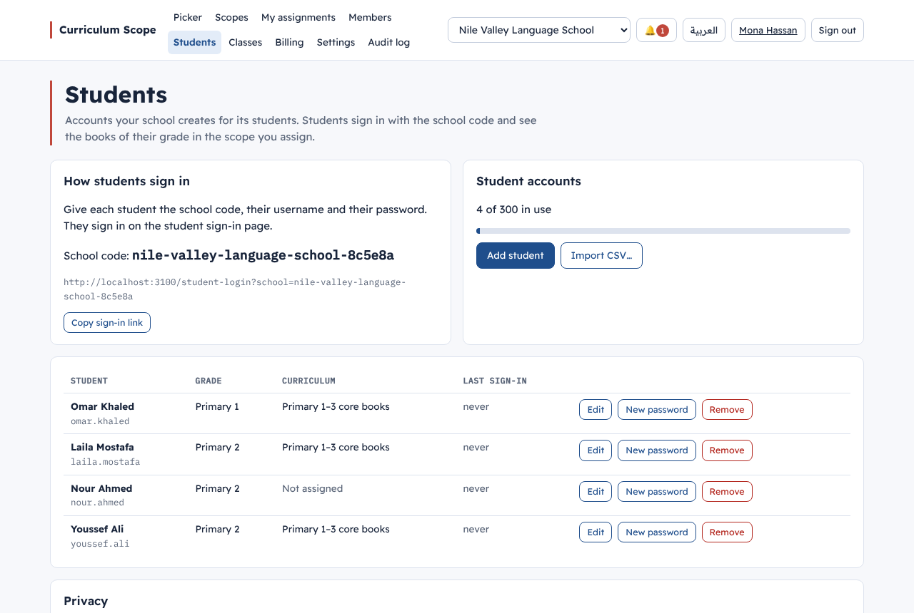

- **How students sign in**: the school code and a sign-in link with the code
  filled in. **Copy sign-in link** copies it. On this test server the link
  starts with `http://localhost:3100`; on a live server it shows your
  address.
- **Add student**: a username (3–40 letters, digits, dots, dashes or
  underscores), the student's name, the grade, and the **Curriculum**: the
  scope whose books the student sees.

  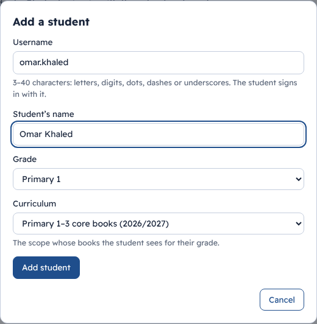

- The password is shown **once**, with the school code. Write it down or
  **Download passwords (CSV)**. **New password** in the list sets a fresh one
  and signs the student out everywhere.

  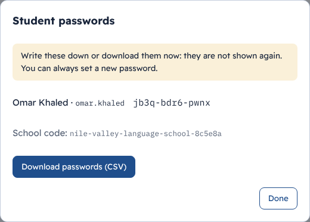

- **Import CSV…** adds up to 300 students from a spreadsheet with the columns
  `username`, `name`, `grade` (1–12) and, optionally, `scope` (a scope's
  name). In Excel, save as "CSV UTF-8". **Download a template** gives the
  layout. The file is checked first: problems are listed by line, and nothing
  is imported until there are none.

  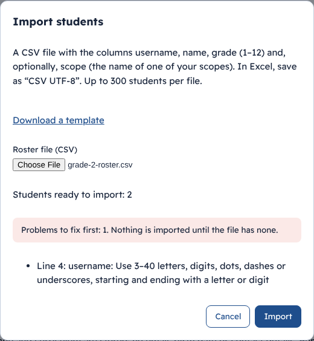

- **Edit** changes a student's name, grade or curriculum; **Remove** deletes
  the account for good.
- **Privacy**: only each student's name, username, grade and curriculum are
  stored. Platform staff see only how many student accounts a school has.

### The student portal

Students open the sign-in link (or **Student? Sign in with your school
account** on the sign-in page) and enter the school code, their username and
their password.

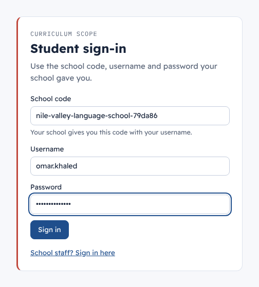

The portal opens on **Today**: tests open now, homework to do and missed, and
work returned this week. **Homework**, **Tests** and **Grades** are described in
[section 12](#12-classes-homework-tests-and-grades). **My books** (**My
curriculum**) shows the books of their grade, grouped like the picker, with the
kind of each book. Students can change their password and switch to Arabic.
They cannot change the list of books; it says to ask a teacher if something is
missing.

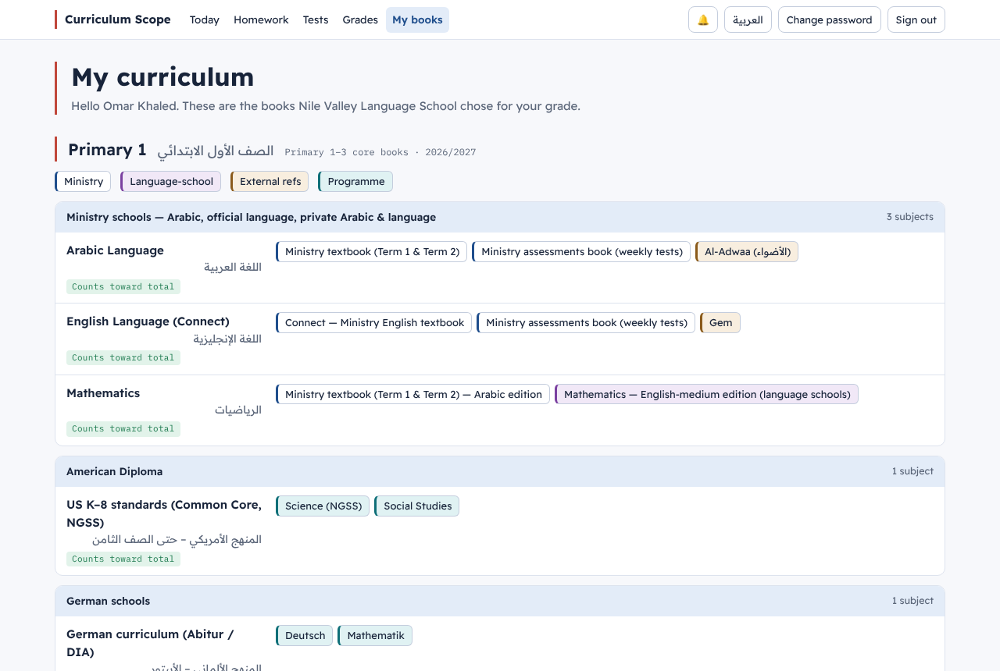

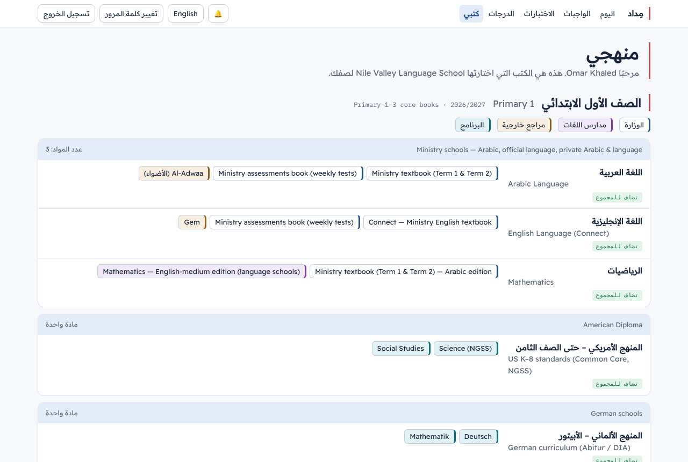

## 12. Classes, homework, tests and grades

When student accounts are on, owners and admins see **Classes** in the menu. A
class has a grade, students and teachers. Its teachers set daily homework and
online tests, and the marks come together in a gradebook.

- A **teacher** is any member added to a class for a subject. Teachers see
  **My classes**, only the classes they teach, and set and mark work only in
  their own subjects. Other teachers of the class can look but not change.
- Owners and admins see and manage every class.
- No mark is given by AI: every mark comes from a teacher, or from a test's
  answer key by fixed rules.

### Setting up a class (owner or admin)

**Classes → New class**: a name, the grade and the **Curriculum**, the scope
whose books the class uses.

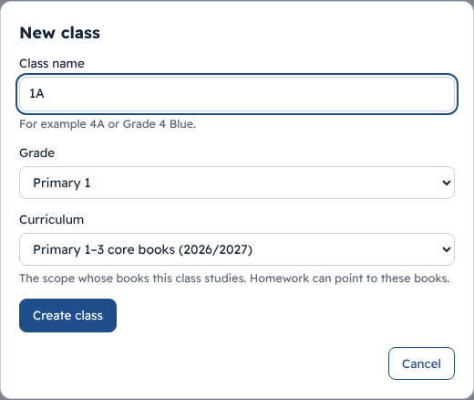

On the class page:

- **Choose students** lists the students of the class's grade first.
- **Add teacher** gives a member a subject in this class. A member can teach
  several subjects, and a subject can have several teachers.

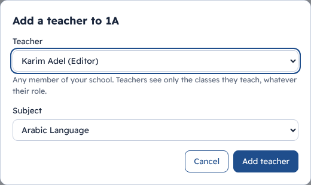

The class page lists its homework and its tests, the students and the
teachers. **Gradebook** opens the class's marks. **Edit class**, **Archive**
and **Delete** are for owners and admins.

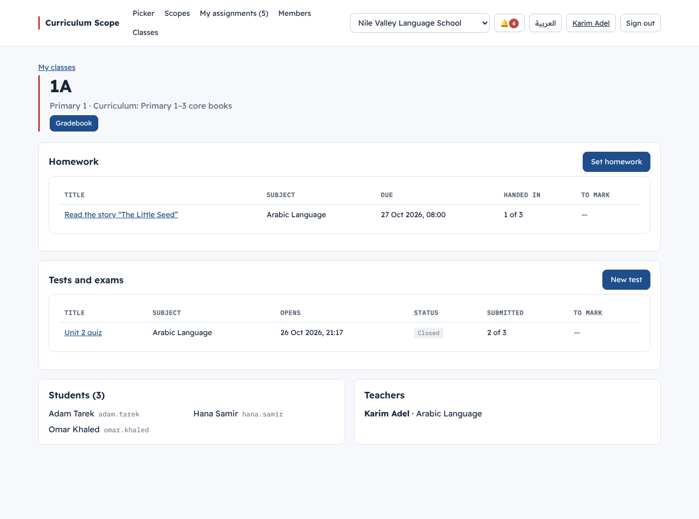

### Homework

**Set homework** asks for:

- the subject, a title and instructions;
- books from the class's curriculum;
- the due time, and **Show it to students later** to schedule it;
- the **Marks** (leave empty for homework without marks);
- whether work handed in after the due time is accepted (it is marked late).

Worksheets (photos or PDFs) can be attached on the homework's page. The
class's students get a notification in their own language.

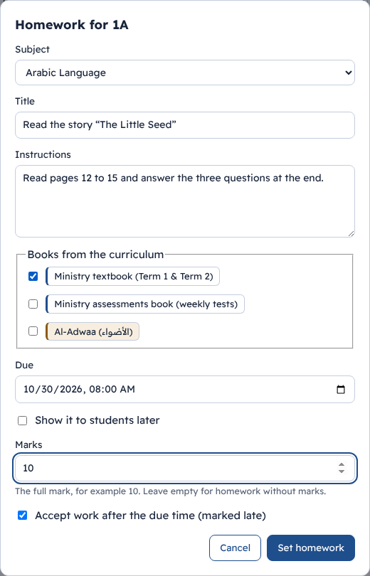

**Suggest with AI** appears in the form for new homework when your school has
AI requests (a platform administrator turns them on and sets how many a
month). Give the topic and, if you like, paste the part of the lesson the
homework should be on; choose the kind (practice exercises, reading and
questions, writing, a small research task or revision), about how many minutes
it should take, and the language. The suggestion shows its title, the
instructions for students, the time it should take and notes for you (what it
checks, the expected answers). **Use this suggestion** puts the title and
instructions in the form; edit them, then set the homework as usual. Nothing is
set until you do. AI can be wrong, so read it first. Do not paste students'
names or work.

Students see it on **Today** and under **Homework**. They write an answer,
attach photos or a PDF, and **Hand in**. Until the work is marked, **Take back**
lets them change it.

Every file is checked before anyone can open it, usually within seconds: it
shows **Being checked…** until then, and the list updates by itself. Files are
scanned for viruses, and large photos are made smaller, which also removes the
information phones store in them, such as where the photo was taken. A file
with a virus is deleted and shows **Virus found: deleted**; whoever uploaded it
is told, and so are the school's owners and admins. A photo that cannot be read
is deleted too, and its uploader is asked to upload it again.

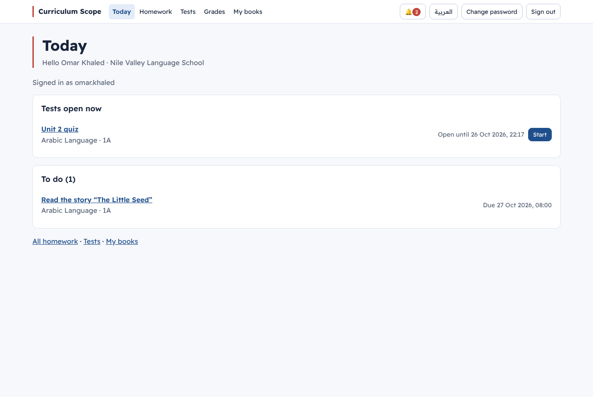

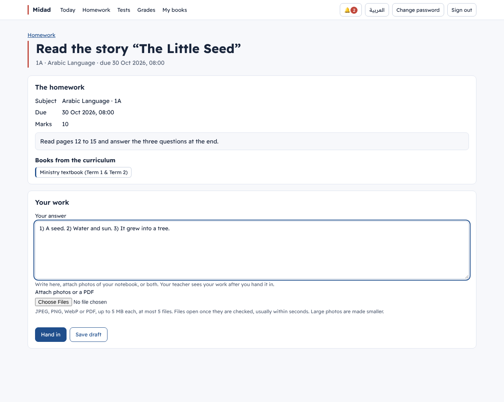

On the homework's page, the teacher sees who handed in, and which work is late
or missing.

- **Open** a student's work to give a mark and comments, then **Return to
  student**.
- **Return marked work** returns all marked work at once.
- Work done on paper can be marked the same way, without a hand-in.

Students see a mark only once it is returned.

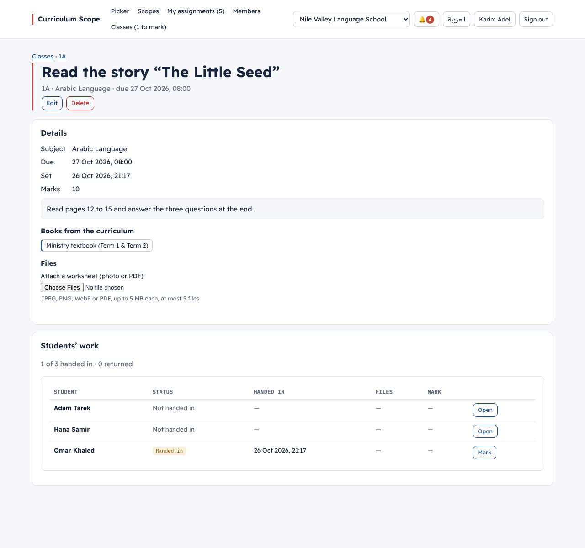

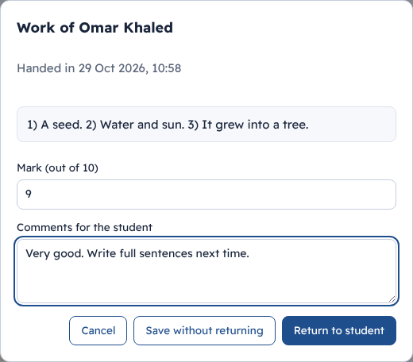

### Online tests and exams

**New test** on the class page asks for:

- the subject, a title and instructions, and quiz or exam;
- when it opens and closes;
- an optional time limit, counted from when each student starts;
- the number of attempts;
- when students see their results: as soon as they submit, when the test
  closes, or when you release them.

Rules you can turn on:

- questions, or choices, in a different order for each student;
- a start code that you give in the room;
- each student continues only on the device where they started;
- show the correct answers with the results, after the test closes.

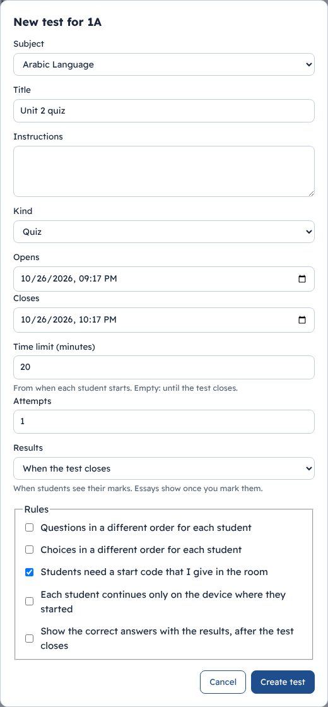

**Add question** offers five kinds:

- **One correct choice** and **Several correct choices** (2 to 10 choices);
- **True or false**;
- **Short answer**: list every accepted answer, one per line. Capitals,
  spaces, Arabic diacritics and letter forms (أ/ا, ى/ي, ة/ه) do not matter.
- **Written answer**, which the teacher marks.

Each question has its own points. With several correct choices, wrong choices
take marks away, never below zero.

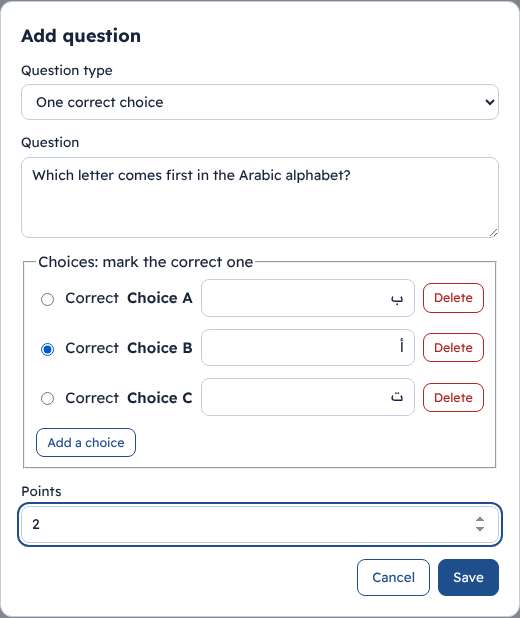

**Suggest questions with AI** appears next to **Add question** when your school
has AI requests (a platform administrator turns them on and sets how many a
month). Give the topic and, if you like, paste the part of the lesson the
questions should come from; choose how many (up to 10), the kinds, the
difficulty and the language. The suggestions come back with their answers and
a short reason for each. Untick the ones you do not want and choose
**Add selected**: they become ordinary questions, which you can edit, move or
delete. Nothing is added until you choose it. AI can be wrong, so read each
question and its answer first. Do not paste students' names or work.

The test page shows the settings, the start code, and the questions with their
answers. **Publish** tells the class's students.

Once a student has started, the questions and the timing rules can no longer
change. You can still change the title, the results settings and the closing
time; a later closing time also gives students who are working more time.

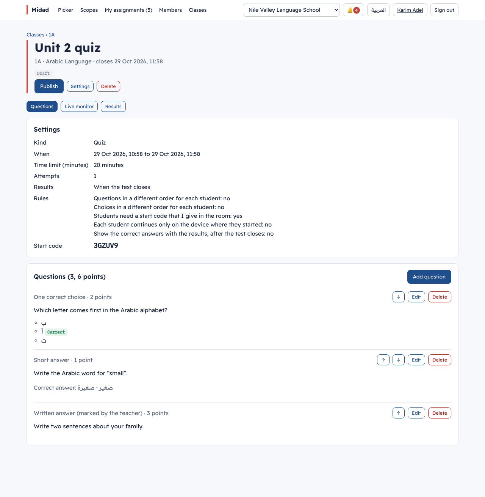

Students start from **Today** or **Tests**. The test's page says what their
teacher can see, and asks for the start code if the test has one.

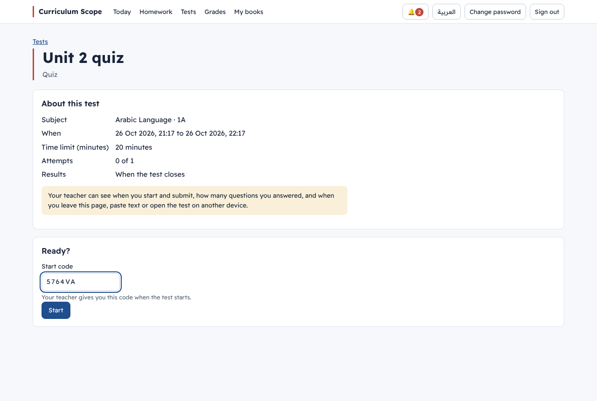

The server keeps the time, and answers save as students go. When the time is
up, the answers are submitted automatically.


**Live monitor** updates every 5 seconds. It shows who has not started, who is
working (online or not, answers given, time left) and who submitted, with what
the page noticed:

- leaving the test page, and for how long;
- pasting text (only how much was pasted, never the text);
- losing the connection;
- opening the test on another device.

For one student: **Extra time**, **Submit now**, **Allow this device** (when
each student keeps to one device), **Allow another attempt**, and **Activity**,
the full list of what happened. For everyone: **Close the test now** and **New
code**.

The monitor sees only what a web page can: no camera, microphone or screen
recording. What it notices is a hint, not proof.


**Results** lists each student's attempts and best mark. Written answers show
**To mark**: open the attempt, give a mark and comments (you can also change an
automatic mark), and **Save mark**. With "When I release them", **Release
results** shows the marks to students and tells them.


Students see their mark when the results setting allows, with your comments,
and the correct answers if you chose to show them.


### The gradebook and My grades

**Gradebook** on the class page shows every student's marks in one subject (the
**Subject** list switches). There is a column for each homework with marks and
each published test, oldest first.

- A test counts each student's best marked attempt.
- **Average** counts marked work only: points out of full marks.
- **Missing** counts homework not handed in by its due time, and closed tests
  not taken. It is shown on its own, not as zero.
- **Download CSV** saves the table for a spreadsheet, in your language. The
  download is recorded in the audit log.


Students see their own marks under **Grades**, by class and subject. A
homework mark appears once it is returned, and a test mark once its results are
shown.


### Keeping classroom data

Owners and admins choose how long the school keeps classroom data: **Classes**
→ **Keeping data**. There are three periods, each counted from a homework's due
time or a test's end:

- **Test monitoring records**: when students left the test page, pasted, lost
  the connection or used another device;
- **Students' work**: homework answers and files, and test answers. Hand-in
  times, marks and comments stay;
- **Homework and tests, with their marks**: the whole homework or test. It
  leaves the gradebook.

Every period starts as **Keep (no automatic deletion)**, and nothing is deleted
until you choose one. How long to keep each kind is your school's decision: ask
your legal adviser.

Before saving, the page says how many homework and tests are already past the
new periods. Owners and admins are told, in the app and by email, at least 14
days before anything is deleted.

**Due to be deleted** lists each homework or test, what will go and the date.
Before that date you can:

- open the class's **Gradebook** from the list and download it;
- **Keep** an item whatever the periods say, for example during an appeal. It
  moves to **Kept whatever the periods say**, where **Let the periods apply**
  undoes it;
- change the periods. A longer period cancels the deletions it no longer
  covers.


Homework and test pages say what is due to be deleted and when, and afterwards
what was deleted. A student whose answer was deleted reads that the school
keeps work for a limited time; their mark and the teacher's comments stay.

> **Before real use.** Classes, homework, tests and marks hold children's
> personal data. The school needs legal advice under Egypt's data protection
> law before it enters real students' work and marks.

## 13. Organization settings: API keys, webhooks, support access

**Settings** (owners and admins):


### Organization

The organization's **Name** and **Default language**, which is used for
invitation emails. **Require two-factor authentication for owners and
admins** (Starter plan and above) makes them set it up before they can open
the organization.

### API keys (Professional and above)

API keys give read-only access to your scopes and the catalogue, for your own
content pipeline (`GET /api/v1/scopes`, `/api/v1/scopes/:id`,
`/api/v1/catalog/versions`). Enter a name and click **Create key**. The key is
shown **once**; copy it then.


The list shows each key's start, when it was last used, and **Revoke**.
Details are in `docs/API_DOCUMENTATION.md`.

### Webhooks (with API access)

Webhooks tell your own systems when a scope changes. Each change is sent to
your address as a signed POST request. Add up to 5 endpoints: an **https**
address of your system (private and local addresses are refused), an optional
description, and which events to send. The events are scope created, renamed
or described, deleted, books added or removed, and notes, assignees, statuses
or due dates changed.

The signing secret is shown once. Your system checks each request's
`X-Midad-Signature` header with it before trusting the request.


The demo's endpoint is a local address (`http://127.0.0.1:…`), which only a
test server accepts. For each endpoint:

- **Send test** sends a test event.
- **Deliveries** shows what was sent and the result.
- **Edit** changes the address, the events, or switches the endpoint off.
- **New secret** replaces the signing secret.
- **Delete** removes the endpoint.

Failed deliveries are retried; an endpoint that keeps failing is switched off
and marked.


In **Deliveries**, open **Payload** to see what was sent, and use **Send
again** to repeat a delivery. **Download history (CSV)** saves the kept
deliveries. Deliveries are kept for 30 days.

### Support access (owner)

The platform's support team **cannot see your scopes** unless the owner
allows it here, with a reason and a duration (for example 24 hours). Every
view by support is recorded in your audit log. **Revoke** ends it early.


### Danger zone (owner)

**Delete organization** permanently deletes the organization with all its
scopes, members, invitations, API keys and billing records. You confirm it by
typing the organization's name and your password.

## 14. Audit log

**Audit log** (owners and admins) is the organization's security and change
history: sign-ins, scope changes, members, invitations, billing, API keys,
webhooks, support access, students, classes, homework, tests and gradebook
downloads. The plan decides how long entries are
kept (7 to 730 days). **Filter** by the start of an action, such as
`scope.`, `member.` or `billing`. **Older entries** loads more.


**Who** shows the person's email. Students have no email, so a student's
sign-in shows "user" there and the username under **Details**. Wide entries
scroll sideways inside the table.

## 15. Your account

Click your name in the top bar.


- **Profile**: your name and language, and your email choices:
  - emails when the catalogue changes for your scopes;
  - emails when books are assigned to you: right away, one summary each
    morning (from 8:00 Cairo time, across all your organizations), or none;
  - reminders when your books are due soon or overdue.
- **Password**: change it with your current password; your other sessions
  are signed out.
- **Security**: **Set up two-factor authentication**. Scan the QR code with an
  authenticator app (Google Authenticator, Microsoft Authenticator,
  1Password…) or type the key, then enter the 6-digit code. Save the recovery
  codes shown next; each works once if you lose your phone. Platform
  administrators must keep two-factor authentication on.

  

- **Active sessions**: where you are signed in, with **Sign out** for each
  and **Sign out all other sessions**.
- **Organizations**: yours, with your role, and **Create organization**.
- **Your data**: **Download my data (JSON)** (your profile, memberships,
  sessions, notifications and recent activity) and **Delete my account**.
  Transfer or delete the organizations you own first.

## 16. Arabic and phones

**العربية** in the top bar switches the whole interface to Arabic, laid out
right to left; **English** switches back. Your choice is saved in your
account. Catalogue entries keep their English and Arabic names, and English
book titles are marked so screen readers read them in English.


On a phone, the layout stacks: the menu wraps and stays at the top of the page
rather than following you down. Each subject's books sit under its name, and
the selection bar stays at the bottom.


## 17. Emails the system sends

All emails are plain text, in the person's language. Links to other people's
data always need signing in. Examples from the demo (links shortened):

**Confirm your email** (on sign-up; the link expires in 48 hours)

```text
Hello Mona Hassan,

Confirm your email address to activate your account:
https://…/verify-email?token=…

The link expires in 48 hours. If you did not sign up, ignore this message.

— Midad
```

**Invitation** (expires in 7 days)

```text
Mona Hassan invited you to join Nile Valley Language School as editor.

Accept the invitation:
https://…/invite?token=…

The invitation expires in 7 days.

— Midad
```

**A book was assigned to you** (right away; or one morning summary, as you
choose)

```text
Mona Hassan assigned you a book to follow up in the scope “Primary 1–3 core books” (Nile Valley Language School):
• Ministry assessments book (weekly tests)

See your books, their notes and due dates:
https://…/org/…/scopes/…/items?show=mine

You receive this because books were assigned to you. Turn these emails off in your account settings: https://…/account

— Midad
```

**Books due soon or overdue** (each book is reminded once when due soon and
once when overdue; sent from 8:00 Cairo time)

```text
Hello Karim Adel,

These books assigned to you in Nile Valley Language School need attention:

Overdue (1):
• Ministry assessments book (weekly tests) — “Primary 1–3 core books”, was due 19 Oct 2026

Due soon (1):
• Ministry textbook (Term 1 & Term 2) — “Primary 1–3 core books”, due tomorrow

Update their status or see all your books:
https://…/org/…/assignments

You receive this because books with a due date are assigned to you. Each book is reminded once when it is due soon and once when it is overdue. Turn these emails off in your account settings: https://…/account

— Midad
```

**A new catalogue year is published** (to editors, admins and owners)

```text
The 2027/2028 catalogue (Egypt K-12 curriculum — academic year 2027/2028) is now available in Midad. These content scopes of Nile Valley Language School still use an older catalogue:
• Primary 1–3 core books
• Primary 1–3 core books — Campus B

Review what changed for each scope (missing books, new editions, subject changes) and carry it forward:
https://…/org/…/scopes

You receive this because you can edit scopes in Nile Valley Language School. Turn these emails off in your account settings: https://…/account

— Midad
```

**Payment received**

```text
We received EGP 2,900.00 for invoice INV-2026-001000 (Nile Valley Language School). Thank you.

— Midad
```

The system also sends:

- password reset links;
- a notice when your password changes;
- a notice when someone tries to sign up with your address;
- ownership transfers;
- catalogue entries flagged for review;
- the daily summary of assigned books;
- classroom data due to be deleted (to owners and admins, at least 14 days
  ahead);
- the trial-ending reminder and the end of the trial;
- renewal invoices, failed payments and overdue renewals;
- the end of a subscription.

## 18. Platform administration

Platform administrators run the service. Their menu replaces the organization
menu. They must sign in with two-factor authentication. They **do not**
see customers' scopes, notes or students, except while an organization's
owner has granted support access. Then every view is recorded in that
organization's audit log.

### Overview


The **Overview** shows:

- monthly recurring revenue and the last 30 days' revenue;
- active, suspended and new organizations, and the number of users;
- organizations by plan and by billing state;
- **Platform health**: the database, migrations, the background worker, the
  email outbox, failed webhooks, the billing provider and the server;
- **Alerts**: active and recently resolved operational alerts, the
  configured alert channels (email, webhook) and **Send test alert**.

The demo server ran without the background worker, so its health shows **no
heartbeat** and its emails wait in the outbox. A live server runs the worker
and sets an alert channel.

### Organizations


**Search** finds an organization; its name opens it:


- **Suspend organization** / **Restore organization**, with a reason recorded
  in the audit log.
- **Subscription** and **Manual plan assignment**: set a plan, status and
  period end (open-ended for contracts), with optional overrides for seats
  and **Student accounts**. A number there turns the student portal on for
  that school, up to that many accounts.
- Open invoices can be **Mark paid** for payments received offline (bank
  transfer, cheque).
- **Members**, the number of scopes and student accounts.
- **Support access**: with an active grant from the owner, **View customer
  scopes** (audited). Without one: "No active grant. Customer business data is
  not accessible."
- The organization's audit log.

### Users


Search users; **Suspend** or **Restore** an account (with a reason);
**Unlock** an account locked by wrong passwords.

### Catalogue

The catalogue has one version per academic year. A published version is
read-only for content. Its verification marks can still be updated. To
prepare the next year, create a **draft** copied from an existing version:


Opening a version shows its grades and subjects, with **Verified: x/231
subjects, y/1038 materials** and a **Show** filter (all, not verified,
verified, needs review). In a draft, subjects and materials can be added and
edited.


**Verification…** on a subject (or **Verify whole grade…**, or **verify** on a
material) records the result of checking it against an official source:

- **Verified**, with the source (required), an optional link, and optionally
  the subject's materials too;
- **Needs review**, with a public note (required);
- **Not verified**.

Customers see the status, date, source and note, but not who reviewed the
entry. Changing an entry's content in a draft clears its mark.


**Download spreadsheet (CSV)** and **Upload edited spreadsheet…** let you do
the same work in Excel. In a draft, the spreadsheet can also correct entries
and add materials (an empty `material_id`). Save as "CSV UTF-8". Every change
is listed before it is applied, and nothing is saved while the sheet has
problems.


**Publish** makes a draft available to every customer and freezes its
content. Customers whose scopes use an older year are then notified
(section 9). **Archive** keeps an old version readable for existing scopes
but stops new scopes from choosing it.


### Plans


Edit each plan's name, monthly and yearly price (in piastres: 99000 is
EGP 990), limits and features (as JSON; `null` means unlimited), and whether
it is active. Changes apply to new invoices, including a subscription's next
renewal invoice; invoices already issued keep their amount.

### Audit and payment webhooks

**Audit** is the platform-wide audit log, filtered by action, actor email or
organization.


**Webhooks** lists the payment provider's notifications (processed, ignored or
failed), for checking payments.


## 19. Limits and things to know

- **Plan limits** apply as you work. When a limit is reached (seats, scopes,
  exports, students, API requests), the message says which limit and, for the
  owner, links to Billing.
- **Catalogue verification**: the catalogue's entries are being verified
  against official sources. Until a subject shows **✓ Verified**, check it
  against the Ministry's decree or the publisher before contracting content.
- **Payments**: this guide's screenshots use the test-mode checkout. Live
  payments go through Paymob once the account's keys are configured.
- **Students**: the portal is turned on per school by a platform
  administrator. Classes, homework, online tests and the gradebook come with
  it, at no extra price.
- **Classroom files**: photos and PDFs only, up to 5 MB each and 5 per
  piece of work, within the school's storage limit (1 GB unless the platform
  sets more). Each is checked (virus scan, photos made at most 2,000 pixels)
  before it opens. A test has at most 100 questions.
- **Classroom data** is kept until the school sets how long to keep it
  (section 12, Keeping classroom data). Classes and student accounts are not
  deleted by those periods.
- **Integrations**: the read API and webhooks are part of the Professional
  plan and above. Single sign-on (Google, Microsoft) is not available yet.

---

## About this guide

The screenshots are produced by `tests/e2e/user-guide.spec.ts`, using
`npm run docs:screenshots` (config `playwright.guide.config.ts`). It starts the
same test server and fresh database as the end-to-end tests. It then builds
the demo school through the interface, as its people would: sign-up, scopes,
members, notes, a new catalogue year, payment, students, a class with homework,
a test and the gradebook, settings and the admin console. Each screen is saved to `docs/user-guide/images/`. Run it after
changing the interface, and check that the pictures still match the text. The
run fails if a step stops working, and also if a dialog's content is wider
than the dialog.
